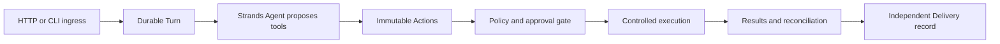

# AgenticIntentGate

AgenticIntentGate is a planned reliability layer that turns model-generated tool intent into controlled external actions. It focuses on durable identities, authorization, human approval, idempotency, recovery, uncertain outcomes, and delivery audit.

**Current status: Day 1 planning preview FROZEN; Day 2 persistent Run/local approval backend implemented (2026-10-06).** Open `GET /` to enter an intent and generate a plan through the same-origin `POST /api/plans`. The backend calls local phi-4-mini once and returns a Plan only after strict JSON, canonical schema, and deterministic trusted semantic validation. The page displays goal, target, steps, risk and validation state, or a safe error. This existing page remains a stateless preview; no tools execute. Only the synthetic `service-demo` context with maintenance revision `1` is supported. Validation establishes the proposal contract, not general intent fidelity or execution feasibility. See the [local run guide](docs/day1-local-run.md), [hardening verification](docs/evidence/day1-hardening-verification.json), and [final freeze record](docs/evidence/day1-final-freeze.json).

Real CPU-model reliability remains **WEAK**: Prompt 4 normal requests succeeded 10/12, and its final browser cohort rendered 3/5 successfully within the unchanged 28-second model budget. Prompt 5's single real-browser read smoke returned a safe 504 / PlanRejected, displayed no Plan, and left the application healthy; it was not retried. Production reliability is **NOT VERIFIED**. Day 2 persistence records generation failures without improving model reliability; execution and MCP remain deferred.

Day 2 implements the frozen [persistent Run/state/SQLite/API contracts](docs/day2-state-architecture-freeze.md) and [ADR-012](docs/adr/ADR-012-persistent-runs-local-approval.md). The [gap audit](docs/day2-repository-audit.md) and [implementation plan](docs/day2-implementation-plan.md) retain their historical architecture-only status. The local gate records one versioned human decision; Approved executes no tools and LOCAL_USER establishes no authentication. [Prompt 2 verification](docs/evidence/day2-backend-verification.json) records deterministic persistence, concurrency, process-restart and package results. Day 1 `/api/plans` remains a preview without Run or execution authority.

Day 2 uses the same Python install/start commands in the local run guide. Production startup always validates the SQLite schema, all persisted Plans and linked decision/audit history, then completes deterministic recovery before serving. `AIG_DB_PATH` defaults to `.runtime/day2-runs.sqlite3`, resolved relative to startup cwd; an optional server-side override must select an ordinary local file. DB/WAL/SHM files are ignored. Use exactly one application process/worker per DB and stop the previous process before restarting.

| Backend route | Result |
| --- | --- |
| `POST /api/runs` with the existing `{ "text": "..." }` Intent | 201 Run + Location after one planning attempt: Ready, AwaitingApproval, or durable PlanRejected |
| `GET /api/runs/{run_id}` | 200 immutable snapshot; every stored state is readable; no generation or state mutation |
| `POST /api/runs/{run_id}/approval` | 200 Approved/Rejected for one valid decision on AwaitingApproval with matching expected_version |

Example using the backend directly:

```powershell
$run = Invoke-RestMethod -Method Post -Uri http://127.0.0.1:8000/api/runs `
  -ContentType 'application/json; charset=utf-8' `
  -Body '{"text":"Plan to read the service-demo record."}'
Invoke-RestMethod -Uri "http://127.0.0.1:8000/api/runs/$($run.run_id)"
# For an AwaitingApproval Run only, the decision body is:
# {"decision":"APPROVE","expected_version":4,"reason":"Reviewed locally"}
```

READ_ONLY reaches Ready at v4; both write risks reach AwaitingApproval at v4. One APPROVE/REJECT commits decision, terminal state v5 and audit together. Repeating the old version returns 409 STALE_RUN_VERSION; deciding with the current terminal version returns 409 INVALID_RUN_TRANSITION. A normal model timeout after Run acceptance returns 201 PlanRejected and is retrievable later. Operational failures use `{run_id,error:{code,message}}`; a known ID on a 503 is a lookup handle, not confirmed acceptance.

Startup rejects interrupted IntentReceived/PlanGenerating Runs with RECOVERY_INTERRUPTED, routes a stored PlanValidated using only trusted risk policy, and preserves every other state. It never retries generation. Invalid schema/data prevents serving. The model call remains owned by its HTTP request; observed cancellation attempts one guarded rejection before Plan acceptance and preserves an already committed Plan. SQLite calls are short synchronous operations; production throughput, physical inference cancellation and hardware/cloud durability are not established by this local slice. Approval UI belongs to a later prompt.

The [repository audit](docs/day1-repository-audit.md), [minimal contracts and state flow](docs/day1-architecture-freeze.md), [implementation plan](docs/day1-implementation-plan.md), and [ADR-011 scope decision](docs/adr/ADR-011-day1-planning-preview.md) preserve the original design decisions. Prompt 2 implements the backend; Prompt 3 adds one static page and browser tests, without a frontend build pipeline or separate server. Prompt 4 closes boundary regressions and measures repeatability without adding features, retries or execution. Prompt 5 reviews that foundation without changing product code, schemas, dependencies or timeout budgets. The local model endpoint and actual wire ID remain required server-side configuration.

The Stage 1 reliability architecture remains frozen as the later execution design. Its former blanket “implementation deferred until 2027” schedule is superseded for the current local planning sprint by ADR-011. The broader reliability/cloud implementation remains deferred and requires its own entry review and authorization. MiniStack is optional and is not needed for Day 1.



The later reliability design is one Python application with bounded synchronous processing and explicit resume/recover commands. SQLite serves that local execution mode; DynamoDB serves AWS mode. Bedrock supplies the later cloud model, and AgentCore hosts the application without owning durable business state. Voice is post-MVP. These components are not required to generate a planning preview.

For the later execution system, read the [project charter](docs/stage1-project-charter.md), [architecture](docs/stage1-architecture.md), [contracts](docs/stage1-contracts.md), and [historical consistency review](docs/stage1-review.md). Its [implementation plan](docs/stage1-implementation-plan.md) remains the deferred reliability roadmap, rather than the next sprint task.

`research/` contains immutable Stage 0 source-study and Stage 0.5 local-reproduction reports. Their observations explain the reliability requirements; they are not our implementation. [STAGE1_HANDOFF.md](STAGE1_HANDOFF.md) is preserved as supplied. Its archived manifest, reproduction code, and review-package references are not prerequisites for this architecture; only the reports included here were used.
