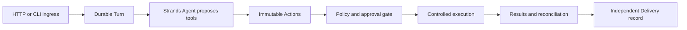

# AgenticIntentGate

Day 3 Prompt 3 adds [verified local capability, separate Action authorization and one controlled demo execution](docs/day3-prompt3-authorization-execution.md) to the [Prompt 2 durable Action foundation](docs/day3-prompt2-action-persistence.md). This is opt-in, explicit SQLite v2 composition, not production authentication. Default `aig-plans`/v1 and the existing UI do not expose Action execution. See the new guide for private provisioning, isolated storage and single-owner startup; verification results are recorded there.

AgenticIntentGate records an Intent as a durable local Run, independently validates the proposed Plan, recomputes trusted risk, and gates write-risk proposals on one local approval decision. The default Day 2 composition does not execute tools. The separate Day 3 demo requires explicit admission, verified authorization and an explicit execute command; approval never dispatches a tool. General production execution remains deferred.

**Current status: Day 2 Final Freeze = PASS.** Persistence, local approval, Run UI/browser E2E and recovery/idempotency hardening are complete. Ignored, regenerable cache deletion is **ENVIRONMENTAL_NON_BLOCKING**: environment policy prevented physical deletion, but closeout verified zero tracked cache/temp or DB/WAL/SHM artifacts, zero repository test databases, zero test processes/listeners, no secret exposure, and passing regression/quality/package gates. No cache was claimed deleted. See the [Day 2 final freeze](docs/day2-final-freeze.md) and [final evidence](docs/evidence/day2-final-freeze.json). Open `GET /` to create a durable Run through same-origin `POST /api/runs`. The Run console displays server-authoritative Run ID/state/version, original Intent, UTC timestamps, validated Plan, trusted risk/approval requirement and safe planning failure. Local Approve/Reject submits the displayed version; **Approved means approval only and does not execute a tool**. The intentional legacy stateless `POST /api/plans` preview remains below the Run console with unchanged API behavior, but has no durable Run, approval or execution authority. Only synthetic `service-demo` / maintenance revision `1` is supported. Validation establishes the proposal contract, not general intent fidelity or execution feasibility. See the [local run guide](docs/day1-local-run.md); [Day 1 freeze evidence](docs/evidence/day1-final-freeze.json) is historical.

**Current local LLM runtime: Ollama**, configured through `LOCAL_LLM_BASE_URL=http://127.0.0.1:11434/v1` and required `LOCAL_LLM_MODEL=<exact installed tag>`. Migration inspection found `phi4-mini:latest`; verify your own `ollama list` instead of assuming it. The unchanged generic `ModelProvider` boundary uses `LocalOpenAIProvider` and a local OpenAI-compatible API, not an Ollama SDK or cloud provider. Foundry Local is retired from all active setup/configuration; see the [migration record](docs/day2-ollama-runtime-migration.md) and [migration evidence](docs/evidence/day2-ollama-migration.json). The initial provider smoke failed strict JSON parsing. The explicit JSON-mode repair subsequently passed one direct provider, one real `/api/plans`, and one real `/api/runs` smoke, each with one model call and unchanged strict validation. These three local observations do not establish production reliability.

**Historical Foundry evidence, not Ollama results:** Day 1 Prompt 4 normal requests succeeded 10/12, and its final browser cohort rendered 3/5 successfully within the unchanged 28-second model budget. Prompt 5's single real-browser read smoke returned a safe 504 / PlanRejected, displayed no Plan, and left the application healthy; it was not retried. The historical CPU-model reliability assessment remains **WEAK** and does not measure Ollama reliability. Production reliability is **NOT VERIFIED**. Day 2 persistence records generation failures without improving model reliability; execution and MCP remain deferred.

Day 2 implements the frozen [persistent Run/state/SQLite/API contracts](docs/day2-state-architecture-freeze.md) and [ADR-012](docs/adr/ADR-012-persistent-runs-local-approval.md). The [gap audit](docs/day2-repository-audit.md) and [implementation plan](docs/day2-implementation-plan.md) retain their dated pre-implementation snapshots. The local gate records one versioned human decision; LOCAL_USER establishes no authentication or authenticated authorization. [Prompt 2 verification](docs/evidence/day2-backend-verification.json) records deterministic persistence, concurrency, process-restart and package results. [Prompt 3 UI verification](docs/evidence/day2-prompt3-ui-e2e.json) records frontend/real-backend browser acceptance after the separately verified Prompt 2.5 Ollama migration. [Prompt 4 hardening](docs/day2-prompt4-hardening.md) and [evidence](docs/evidence/day2-prompt4-hardening.json) cover repeated recovery, approval races, SQLite failure atomicity, corruption and provider failures. Prompt 3, Prompt 4 and final freeze make no new live model calls. Day 1 `/api/plans` remains a preview without Run or execution authority.

The static Run console has no frontend build stack or browser-local authoritative state. After creation it stores only the lookup ID in `?run_id=<uuid>`; reload and **Refresh Run** use GET without planning, approval or mutation. Unknown approval need is displayed as unknown, not false. AwaitingApproval exposes only Approve/Reject and an optional reason: blank is omitted, non-empty text is preserved. Both buttons lock immediately. A conflict or unconfirmed decision requires explicit refresh; the UI never retries or replays an approval. Approved/Rejected show a read-only state/version summary; the frozen API does not expose the stored reason or actor, so the page does not fabricate them. No approval UI claims authenticated consent, authorization or execution.

Default tests use existing Playwright Chromium through installed headless Edge, controlled providers and isolated temporary local SQLite files/ports. `tests/browser/test_run_frontend.py` is the DOM/unit lane with controlled HTTP responses, not backend E2E proof. `tests/browser/test_run_ui_e2e.py` uses real HTTP, RunService, validator and SQLite without browser network interception or live LLM access. Prompt 3 acceptance passed 39 Run frontend cases, 13 real-backend browser cases and 622 deterministic tests. Prompt 4 added 64 cases, reaching 686 passed with zero failures/errors and five live tests deselected. The final freeze audit performed a fresh complete run; its documentation-only closeout reuses that result because executable files are unchanged. Run it with `.venv/Scripts/python.exe -m pytest -q`, or target those modules separately. Live tests remain opt-in and are not deterministic reliability or production-readiness proof.

Cleanup observations are scoped to their verification run; old pytest directory names/counts in Prompt 3 evidence are historical, not current host inventory. The final freeze evidence records current process/listener and artifact checks. External pytest-managed fixture retention is **NON-BLOCKING** only when it is outside the repository, has no test process/listener or tracked artifact, and affects no production/user DB. No global cache cleanup is required.

Day 2 uses the same Python install/start commands in the local run guide. Production startup always validates the SQLite schema, all persisted Plans and linked decision/audit history, then completes deterministic recovery before serving. `AIG_DB_PATH` defaults to `.runtime/day2-runs.sqlite3`, resolved relative to startup cwd; an optional server-side override must select an ordinary local file. DB/WAL/SHM files are ignored. Use exactly one application process/worker per DB and stop the previous process before restarting.

| Backend route | Result |
| --- | --- |
| `POST /api/runs` with the existing `{ "text": "..." }` Intent | 201 Run + Location after one planning attempt: Ready, AwaitingApproval, or durable PlanRejected |
| `GET /api/runs/{run_id}` | 200 immutable snapshot; every stored state is readable; no generation or state mutation |
| `POST /api/runs/{run_id}/approval` | 200 Approved/Rejected for one valid decision on AwaitingApproval with matching expected_version |

Example using the backend directly:

```powershell
$run = Invoke-RestMethod -Method Post -Uri http://127.0.0.1:8000/api/runs `
  -ContentType 'application/json; charset=utf-8' `
  -Body '{"text":"Plan to read the service-demo record."}'
Invoke-RestMethod -Uri "http://127.0.0.1:8000/api/runs/$($run.run_id)"
# For an AwaitingApproval Run only, the decision body is:
# {"decision":"APPROVE","expected_version":4,"reason":"Reviewed locally"}
```

READ_ONLY reaches Ready at v4; both write risks reach AwaitingApproval at v4. One APPROVE/REJECT commits decision, terminal state v5 and audit together. Repeating the old version returns 409 STALE_RUN_VERSION; deciding with the current terminal version returns 409 INVALID_RUN_TRANSITION. A normal model timeout after Run acceptance returns 201 PlanRejected and is retrievable later. Operational failures use `{run_id,error:{code,message}}`; a known ID on a 503 is a lookup handle, not confirmed acceptance.

Startup rejects interrupted IntentReceived/PlanGenerating Runs with RECOVERY_INTERRUPTED, routes a stored PlanValidated using only trusted risk policy, and preserves every other state. It never retries generation. Invalid schema/data prevents serving. The model call remains owned by its HTTP request; observed cancellation attempts one guarded rejection before Plan acceptance and preserves an already committed Plan. SQLite calls are short synchronous operations; production throughput, physical inference cancellation and hardware/cloud durability are not established by this local slice. There is no production authentication, distributed consistency or production-ready multi-user approval claim.

The [Day 1 repository audit](docs/day1-repository-audit.md), [minimal contracts and state flow](docs/day1-architecture-freeze.md), [implementation plan](docs/day1-implementation-plan.md), and [ADR-011 scope decision](docs/adr/ADR-011-day1-planning-preview.md) preserve the original preview design. Day 2 Prompt 1 freezes Run contracts; Prompt 2 implements persistence/approval; Prompt 2.5 migrates the runtime and repairs JSON-mode requests; Prompt 3 adds the Run console/browser E2E; Prompt 4 validates hardening; Prompt 5 audits and freezes this completed slice without changing product code, schemas, dependencies or timeout budgets. The local model endpoint and exact wire ID remain required server-side configuration; no cloud LLM is required.

The following Stage 1 diagram is **deferred execution design, not the current Day 2 architecture**. Its former blanket “implementation deferred until 2027” schedule is superseded for the current local planning sprint by ADR-011. The broader reliability/cloud implementation remains deferred and requires its own entry review and authorization. MiniStack is optional and is not needed for the current local path.



The later reliability design is one Python application with bounded synchronous processing and explicit resume/recover commands. SQLite serves that local execution mode; DynamoDB serves AWS mode. Bedrock supplies the later cloud model, and AgentCore hosts the application without owning durable business state. Voice is post-MVP. These components are not required to generate a planning preview.

For the later execution system, read the [project charter](docs/stage1-project-charter.md), [architecture](docs/stage1-architecture.md), [contracts](docs/stage1-contracts.md), and [historical consistency review](docs/stage1-review.md). Its [implementation plan](docs/stage1-implementation-plan.md) remains the deferred reliability roadmap, rather than the next sprint task.

`research/` contains immutable Stage 0 source-study and Stage 0.5 local-reproduction reports. Their observations explain the reliability requirements; they are not our implementation. [STAGE1_HANDOFF.md](STAGE1_HANDOFF.md) is preserved as supplied. Its archived manifest, reproduction code, and review-package references are not prerequisites for this architecture; only the reports included here were used.
