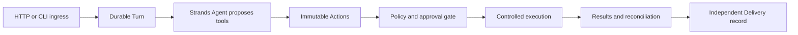

# AgenticIntentGate

AgenticIntentGate is a planned reliability layer that turns model-generated tool intent into controlled external actions. It focuses on durable identities, authorization, human approval, idempotency, recovery, uncertain outcomes, and delivery audit.

**Current status: Day 1 local planning preview, final freeze review (2026-10-04).** Open `GET /` to enter an intent and generate a plan through the same-origin `POST /api/plans`. The backend calls local phi-4-mini once and returns a Plan only after strict JSON, canonical schema, and deterministic trusted semantic validation. The page displays goal, target, steps, risk and validation state, or a safe error. This is a stateless preview; no tools execute. Only the synthetic `service-demo` context with maintenance revision `1` is supported. Validation establishes the proposal contract, not general intent fidelity or execution feasibility. See the [local run guide](docs/day1-local-run.md), [hardening verification](docs/evidence/day1-hardening-verification.json), and [final freeze record](docs/evidence/day1-final-freeze.json).

Real CPU-model reliability remains **WEAK**: Prompt 4 normal requests succeeded 10/12, and its final browser cohort rendered 3/5 successfully within the unchanged 28-second model budget. Prompt 5's single real-browser read smoke returned a safe 504 / PlanRejected, displayed no Plan, and left the application healthy; it was not retried. Production reliability is **NOT VERIFIED**. Approval, execution, persistence and MCP remain deferred.

The [repository audit](docs/day1-repository-audit.md), [minimal contracts and state flow](docs/day1-architecture-freeze.md), [implementation plan](docs/day1-implementation-plan.md), and [ADR-011 scope decision](docs/adr/ADR-011-day1-planning-preview.md) preserve the original design decisions. Prompt 2 implements the backend; Prompt 3 adds one static page and browser tests, without a frontend build pipeline or separate server. Prompt 4 closes boundary regressions and measures repeatability without adding features, retries or execution. Prompt 5 reviews that foundation without changing product code, schemas, dependencies or timeout budgets. The local model endpoint and actual wire ID remain required server-side configuration.

The Stage 1 reliability architecture remains frozen as the later execution design. Its former blanket “implementation deferred until 2027” schedule is superseded for the current local planning sprint by ADR-011. The broader reliability/cloud implementation remains deferred and requires its own entry review and authorization. MiniStack is optional and is not needed for Day 1.

The later reliability design is one Python application with bounded synchronous processing and explicit resume/recover commands. SQLite serves that local execution mode; DynamoDB serves AWS mode. Bedrock supplies the later cloud model, and AgentCore hosts the application without owning durable business state. Voice is post-MVP. These components are not required to generate a planning preview.

For the later execution system, read the [project charter](docs/stage1-project-charter.md), [architecture](docs/stage1-architecture.md), [contracts](docs/stage1-contracts.md), and [historical consistency review](docs/stage1-review.md). Its [implementation plan](docs/stage1-implementation-plan.md) remains the deferred reliability roadmap, rather than the next sprint task.

`research/` contains immutable Stage 0 source-study and Stage 0.5 local-reproduction reports. Their observations explain the reliability requirements; they are not our implementation. [STAGE1_HANDOFF.md](STAGE1_HANDOFF.md) is preserved as supplied. Its archived manifest, reproduction code, and review-package references are not prerequisites for this architecture; only the reports included here were used.
