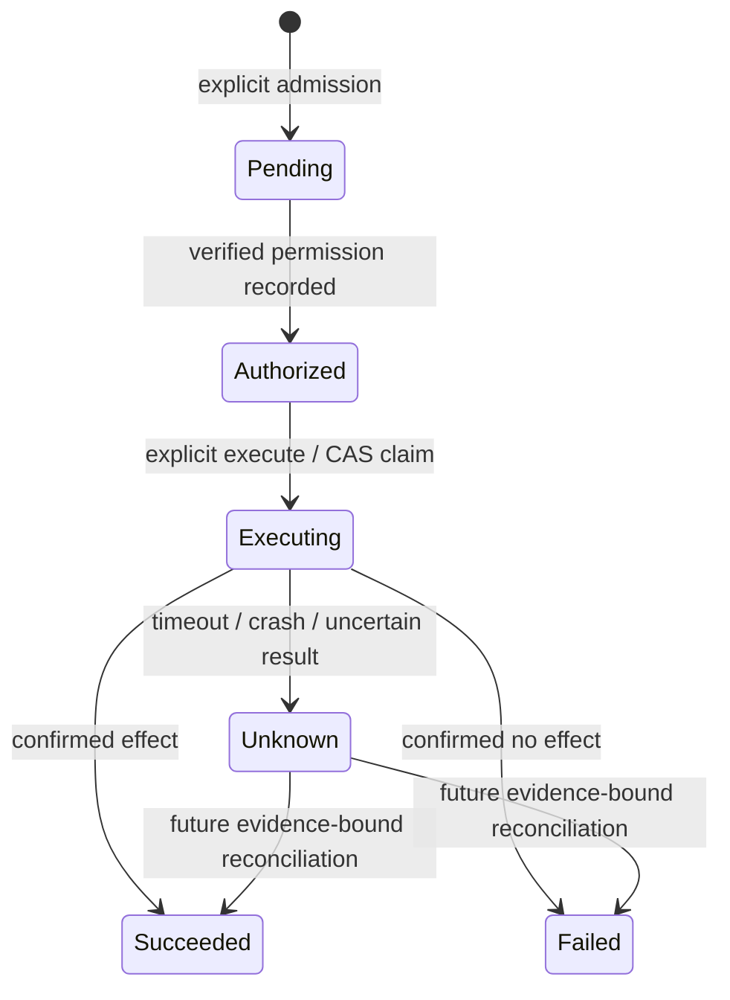

# Day 3 Action / Execution Architecture Freeze

## 1. Context

Status: accepted architecture for Day 3 Prompt 1, 2026-10-07; DOC-ONLY. Nothing in this document is an implemented execution, authentication, migration, or crash guarantee.

Audit HEAD is 622edb4bf030fc0a0f8cd9b43336ad8e8153894b on main, initially clean. The annotated day2-final-freeze tag still resolves to c7d3e1ee051af40c69ec33d888ecf16475a2d789; the sole intervening change is the committed [Day 2 inventory](day2-inventory.md). Reviewed [README](../README.md), [final freeze](day2-final-freeze.md), [Run contract](day2-state-architecture-freeze.md), [hardening](day2-prompt4-hardening.md), domain/application/ports/adapters, four schemas, and the existing deterministic, restart and browser test structure.

The repository actually contains ModelProvider, PlanningService, PlanValidator, RunService, RunRepository, SQLiteRunRepository, recover_runs, and create_app. Its metadata catalog names get_service_record, append_service_note, and set_maintenance_mode, version 1. No executable catalog, Action, executor, authenticated authorization, or Turn implementation exists. [ADR-013](adr/ADR-013-action-ledger-execution-boundary.md) records this bounded extension; the [implementation plan](day3-implementation-plan.md) lists later work.

The [architecture evidence](evidence/day3-prompt1-architecture-freeze.json) records this review's decisions, artifact checks and Day 2 preservation proof; it contains no execution acceptance claim.

## 2. Day 2 Frozen Baseline

Preserve the eight Run states: IntentReceived, PlanGenerating, PlanValidated, Ready, AwaitingApproval, Approved, Rejected, PlanRejected. Preserve Run transition guards, immutable Intent/Plan, version semantics, and approval body decision + expected_version + optional reason. Action changes never increment Run.version or alter the existing public Run response.

SQLite v1 remains unchanged in this prompt: runs, approval_decisions, audit_events; STRICT tables, WAL, FULL synchronous, foreign keys, 250 ms busy timeout, short BEGIN IMMEDIATE writes, strict schema/integrity/history validation. The four existing JSON schemas stay byte-identical.

Approved != Executed. LOCAL_USER is an unauthenticated historical marker. Planning remains strict JSON -> schema -> semantic validation -> trusted risk recomputation, at most one provider attempt, no model retry/fallback. Run recovery stays deterministic, model-free, tool-free and convergent.

The [archived final evidence](evidence/day2-final-freeze.json) records 686 passed, 0 failed/errors, 5 live deselected; this is the future regression floor, not a newly executed run. The rollback tag is immutable; restoring code after a later v2 data migration also requires the pre-migration v1 database backup.

## 3. Design Goals

Add an inspectable, durable boundary from a server-loaded approved Plan to one explicitly requested local demo effect. Keep proposal, local approval, verified permission, dispatch, and observed result distinct. Prevent concurrent or duplicate commands from issuing another uncontrolled call. Retain truthful Unknown outcomes across process death and lost local persistence. Reuse the existing validated Run instead of replanning.

## 4. Non-Goals

Prompt 1 creates documentation only. The eventual bounded Day 3 MVP has no Turn/conversation engine, multi-step executor, read-tool execution, APPROVAL_REQUIRED tool execution, arbitrary plugins, shell, MCP, cloud, distributed workers/HA, full user authentication/RBAC, authenticated distinct-approver consent, automatic retry/fallback, compensation, or public reconciliation API. Production execution remains outside the local demo scope.

## 5. Turn Decision

Choose Option A, Run + Action. A Run already represents one accepted Intent and one immutable Plan. There is no new conversation slot, repeated agent round, or delivery invariant requiring Turn.

| Dimension | A: Run + Action (chosen) | B: Run + Turn + Action | C: execution fields on Run |
| --- | --- | --- | --- |
| Conceptual necessity | Adds the missing logical effect record | No distinct Turn invariant yet | Saves a name but mixes proposal and effect |
| Lifecycle clarity | Frozen Run gate; separate Action truth | Two proposal owners require mapping | Approved/Executed meanings collide |
| Persistence complexity | Action facts beside existing tables | Adds Turn identity and links | Requires changing frozen Run schema |
| Approval mapping | References immutable Run Plan/decision | Must choose whether Run or Turn owns approval | Couples decision to execution fields |
| Execution mapping | One compiled step per Action | Still needs Action | No independent effect record |
| Idempotency | Action identity and scoped receipts | Turn adds no immediate key guarantee | Run retries and effect retries become ambiguous |
| Auditability | Independent Action event chain | More cross-record consistency checks | Existing Run event chain must change |
| Recovery | Run and Action recovery are separate | Extra Turn recovery states | Risk of replay through Run recovery |
| Future multi-step workflows | Can add atomic multi-Action admission later | Useful only after repeated planning/conversation needs exist | Difficult to represent per-step uncertainty |
| Hackathon reuse | Core plus explicit adapters | More concepts for each adapter | Adapters become tied to Run internals |
| Implementation cost | Smallest safe independent lifecycle | Higher cost without current invariant | Small surface with unacceptable contract changes |

Turn is deferred, not removed from the separately deferred Stage 1 design. This local review selects its own next slice; it does not implement or globally supersede that broader roadmap.

## 6. Plan / Action / Execution Model

| Term | Meaning |
| --- | --- |
| Plan | Immutable validated proposal stored on Run; no effect authority |
| Plan step | Ordered proposed tool/version/arguments |
| Local approval | The recorded Day 2 decision on that immutable proposal |
| Authorization | A server decision about a verified principal and exact Action specification |
| Action | Durable identity and lifecycle for one compiled step's logical operation |
| Execution attempt | One claimed dispatch opportunity for that Action, with its own attempt_id |
| External effect | Change in the separate demo/provider system; not a gate DB fact |
| Execution result | Bounded evidence supporting success, confirmed no-effect failure, or uncertainty |

Action is a durable operation record, not an authorization token and not an attempt. Authorization and attempt records link to it later; they are not fabricated at Action creation.

Creation timing evaluation:

| Point | Decision |
| --- | --- |
| During planning | Reject: output is not yet trusted |
| After PlanValidated | Reject automatic creation: policy gate is incomplete |
| After policy routing | Reject automatic creation: write consent may still be pending |
| Immediately after Approved | Reject automatic creation: approval must not trigger admission/dispatch |
| Explicit Action admission command after Approved | Choose: re-read and validate committed facts, then compile/persist only |

The model supports Run -> 0..N Actions, one per admitted Plan step. Zero is normal before admission or for an ineligible Run. **The MVP admits exactly one Action only for an Approved Run whose entire Plan contains one append_service_note/1 SIDE_EFFECT step targeting service-demo.** A Ready read proposal, any rejected/intermediate Run, set_maintenance_mode, or any multi-step Plan is rejected as a whole. Do not silently execute a subset or treat prior proposed reads as having happened. Future N>1 requires a separately accepted sequencing/all-approvals contract.

Admission must check Run version/state, valid approval decision and immutable Plan in the same gate transaction as Action creation. UNIQUE(run_id, step_index) prevents a second logical Action for that step, regardless of caller key. Repeated admission returns existing IDs only if the complete stored specification matches. Different Runs can intentionally produce different effects; this design does not add cross-Run semantic Intent deduplication.

## 7. Action State Machine

| State | Meaning | Representative version |
| --- | --- | --- |
| Pending | Compiled durable operation; no recorded permission or dispatch | 1 |
| Authorized | One exact-spec permission record exists; current permission still rechecked at execute | 2 |
| Executing | One claim/attempt committed; a call may have begun or completed | 3 |
| Succeeded | Durable positive evidence of the intended effect | 4 |
| Failed | Durable evidence confirms the intended effect did not occur | 4 |
| Unknown | Dispatch/result/commit evidence is insufficient to determine the effect | 4 |

Allowed MVP edges: Pending -> Authorized; Authorized -> Executing; Executing -> Succeeded, Failed, or Unknown. Startup can use the last edge to mark an abandoned claim Unknown once. No same-state rewrite, reverse transition, new attempt, or terminal resurrection is allowed.

Future reconciliation-only edges are Unknown -> Succeeded or Failed with authoritative evidence and CAS (normally v5). They are frozen as extension rules, but no resolver/API is implemented by Prompt 1 or included in the initial Day 3 MVP. Unknown never transitions back to Authorized or Executing under this contract.

Authorized describes a historical grant, not a perpetual right. Six states are justified because the separate authorization command has an observable committed outcome before execution; a five-state design would hide that gate. Expired/revoked credentials or changed policy block execution without silently changing historical authorization. Renewal is deferred.

## 8. Approval vs Authorization vs Execution

Approval is the existing local policy gate. Action admission binds its exact decision_id, immutable Plan hash and Run version; admission does not call a tool. Day 2 consent never supplies a PrincipalContext.

A future transport verifier produces PrincipalContext from a privately provisioned local execution capability. The bounded MVP maps possession of that capability to one server-configured local-demo principal and a fixed allowlist of operations, append_service_note/1 and service-demo. It does not claim a verified human identity, distinct approver, multi-user ownership or full RBAC. Loopback address alone never grants permission. No capability, bad capability, unsupported tool/risk or absent authorizer means deny.

The future capability must contain at least 256 bits of unpredictable entropy, be verified as an Authorization bearer credential without logging it, and map to a stable server-owned subject/scope. No client-supplied subject or role is accepted. Private provisioning, rotation and constant-time verification are implementation requirements, not credentials or code supplied by this prompt.

AuthorizationPort evaluates that trusted principal against the entire compiled specification and server-owned policy. Its permit yields authorization_id, subject_id, spec_digest, policy_revision and authorized_at. These are durable evidence, not a reusable credential. The authorize transaction stores that record with Pending -> Authorized and its event. The execute command freshly verifies the principal and current permission, requires the same grant subject/spec/policy, then claims; if policy changed, fail closed. No hot policy mutation or grant renewal is part of MVP; implementation must drain/stop the predecessor before policy reconfiguration. Revocation after a claim cannot guarantee stopping an already sent effect.

A separate execute command is the only dispatch trigger. The actual APPROVAL_REQUIRED risk remains unsupported for execution until authenticated distinct consent, exact proposal binding and expiry requirements from ADR-004/012 are implemented. The chosen SIDE_EFFECT demo still requires both Day 2 Approved and this new independent authorization gate.

Capability material must be supplied through a private local operator channel in later work, never generated by the model, embedded in checked-in configuration, returned in a Plan, placed in a URL or persisted in the ledger. Future UI uses an ephemeral in-memory credential entry; no cookie/localStorage/sessionStorage authority. Credential storage and general login are not designed here.

## 9. Plan-to-Action Compilation

Use a trusted, versioned ActionCompiler; its input is the reloaded Run/Plan plus validated server decision/catalog/binding facts, never a client-submitted Plan. Reuse PlanValidator and canonical_json, but add execution admission rules:

1. Validate stored Run, decision/history, Plan schema/semantics and trusted aggregate risk.
2. Require Approved/v5 and the entire one-step MVP shape; deny unsupported risk, target, step count or missing executable binding.
3. Resolve exact tool name/version through the server-owned registry; bind adapter_id and binding_revision. A catalog match alone is insufficient.
4. Validate adapter input schema and equality of target/service_id. Canonical JSON serialization sorts keys and fixes encoding; it must not trim, rewrite or reinterpret note text, targets, booleans or numbers.
5. Compute plan_digest and spec_digest with SHA-256 over versioned canonical UTF-8 representations. Bind run_id, Plan hash, step ordinal, tool/version, target, normalized arguments, trusted risk, approval decision, compiler revision, executable binding and stable execution_scope.
6. Persist immutable Action specification plus server UUIDv4 action_id/effect_key. A mismatch during later validation rejects; never silently repair an Action.

For the demo, normalized arguments are the existing service_id and note with the existing bounds (note <=1024 characters; canonical arguments <=4 KiB). Runtime location and credentials come from trusted adapter configuration, not these arguments. A newer binding/policy cannot silently substitute behavior under a previously compiled Action.

## 10. Tool Adapter Boundary

Metadata/policy catalog remains non-callable. A separate executable registry explicitly binds (append_service_note, 1, binding_revision) to one reviewed adapter_id, configured target and capability description. get_service_record and set_maintenance_mode remain unbound. No request field or dynamic import selects an implementation.

execution_scope is a server-provisioned stable logical demo-resource identity, persisted in the Action and external store metadata. It is not a pathname or per-startup/deployment suffix. A changed resource namespace or binding cannot execute an old Action; verify the exact stored scope before claim. Receipt retention and backing-store continuity are part of the provider capability contract, not something a new empty database inherits automatically.

The pre-claim scope check compares local Action/registry facts without external I/O. On its claimed call, the adapter verifies the already provisioned external store's identity before changing business data. It must not silently create/reset a missing store or receipt history. Private demo-resource provisioning is an explicit preparation step, never a GET, authorization or recovery side effect.

Conceptual ToolExecutor input: immutable validated ExecutionSpec + persisted effect_key + attempt_id + bounded deadline/cancellation context. It receives no raw Run, raw HTTP request, gate database connection, Principal credential, generic environment or permission to change Run/Action state. The adapter owns access only to its configured external demo resource.

The ActionExecutionGateway alone obtains a confirmed claim permit and invokes that port once. The adapter alone performs the selected external effect on that invocation. Startup, compiler, model, API parsing, approval, authorization, GET and UI contain no direct effect path. An in-process Protocol is a code boundary, not a malicious-plugin sandbox; only trusted reviewed adapters may be composed.

| Adapter category | Evidence required | Gateway disposition |
| --- | --- | --- |
| SUCCESS | Durable provider/demo receipt binds effect key, target and payload digest | Commit Succeeded and safe receipt reference |
| CONFIRMED_FAILURE | Authoritative evidence proves no intended effect occurred | Commit Failed with fixed safe code |
| UNKNOWN_OUTCOME | Timeout, lost response, partial/ambiguous effect, cancellation, unexpected adapter fault | Commit Unknown when persistence is confirmed |

A generic exception or an HTTP failure alone is not proof of no effect. Malformed/untrusted adapter evidence after dispatch is Unknown. The intended adapter deadline is <=5 seconds and command budget 10 seconds, with short local persistence outside that budget's tool wait; disk/OS faults and external inference/effect cancellation have no hard timing guarantee. No hidden adapter/transport retries are permitted.

The single deterministic adapter appends a note to an isolated separately configured local demo SQLite store. Its external transaction atomically commits the note and a unique effect-key/payload-digest receipt. This file is distinct from the gate DB; never ATTACH it to make a cross-store atomicity claim. It represents a provider with keyed deduplication and receipt lookup, not a production service. Its connection is adapter-owned and never passed from the gate.

## 11. Idempotency and Retry

Control-plane requests: the caller creates and retains a UUIDv4 Idempotency-Key before sending each logical admission/authorize/execute command. Persist accepted receipts with unique (subject_id, operation, resource_id, key) and canonical body fingerprint, including expected version. Authentication and current resource visibility precede receipt lookup. Same key + identical body returns the current snapshot for that accepted command, marked replayed=true, with no state mutation, new event, grant, attempt or dispatch. Same key + different body conflicts. Receipt lookup precedes CAS so loss of a response does not turn an accepted command into a stale-version retry.

Only accepted commands have receipts; validation/auth/CAS rejections make no acceptance promise. Receipts have no TTL/eviction in MVP. A different key cannot bypass Action state or UNIQUE(run_id, step_index). Duplicate execute with a different key cannot claim again; it conflicts even if expected version is current. Different Runs/Actions are distinct business operations and can append distinct notes.

External effects: generate the stable effect_key once on the server with the Action; its persisted scope is (execution_scope, tool_name, tool_version, target). The adapter receives it with the exact normalized payload digest. Request keys, model IDs and attempt IDs must never replace it. The demo's unique receipt enforces same-key/same-payload deduplication and rejects same-key/different-payload without an effect.

| Provider capability | What it can support | After uncertain dispatch |
| --- | --- | --- |
| Keyed deduplication + authoritative lookup | Deduplication within declared scope, retention and payload contract | Future explicit lookup/reconciliation; no MVP resend |
| Keyed deduplication only | Re-send safety only inside the documented key guarantee | Remain Unknown absent conclusive evidence |
| Lookup only | Evidence about prior effect, not generic repeat safety | Look up only under future authorized command; no blind call |
| Neither | No downstream duplicate-effect guarantee | Preserve Unknown for operator investigation |

Default execution retry is NO AUTOMATIC RETRY, independently of Day 2's no-planning-retry rule. MVP permits one attempt per Action. A future retry contract must prove downstream key guarantees/retention, identical key and payload, prior executor quiescence, fresh authorization/consent, and a separately versioned attempt transition. A generic retryable exception is insufficient. Expired key retention or an uncertain provider without keys prohibits replay.

Under the selected single-owner/gateway assumptions, CAS can guarantee one committed local claim and at most one gateway dispatch per Action. It sacrifices automatic eventual completion. It cannot promise exactly-once external effects or at-least-once delivery. The keyed demo gives at-most-one committed note per retained effect key within its own store contract; local gate transactions and external effects are still not one distributed transaction.

Each accepted local state edge/event commits once under CAS and transaction constraints, even when the response is lost. Choosing repeated delivery to improve liveness would be at least once and may duplicate a non-keyed effect. This MVP instead chooses at most one dispatch opportunity and accepts unresolved/lost opportunities; it does not use local exactly-once state mutation as an external guarantee.

## 12. Crash Windows and Unknown Outcomes

Executing means a committed dispatch opportunity, not proof that bytes left the process. Dispatch occurs only after a confirmed winning commit. If claim persistence is uncertain, return a safe storage error and do not invoke the adapter.

| Case | Durable observation | Startup/recovery | Automatic retry | Reconciliation need |
| --- | --- | --- | --- | --- |
| A: executable, dies before tool call | Authorized if claim not committed; Executing if claim committed before dispatch | Authorized unchanged; Executing -> Unknown | None; a new explicit execute is allowed only for unclaimed Authorized with fresh permission | Claimed branch needs evidence even if the actual call never happened |
| B: call starts, dies before response | Executing; external effect may or may not exist | Unknown once; no tool call | Prohibited | Future authoritative lookup/operator investigation |
| C: tool success, dies before result commit | Executing; external receipt may prove an effect | Unknown, not Failed | Prohibited | Future lookup can support Succeeded |
| D: tool confirms failure, dies before result commit | Executing; response evidence may be lost | Unknown, not inferred Failed | Prohibited | Future reliable no-effect evidence can support Failed |
| E: local success commits, caller loses HTTP response | Succeeded + result/event + accepted command receipt | Leave unchanged | No dispatch; same-key command replay/GET reads the result | Not needed if the ledger is valid |

A confirmed result transaction failure rolls back local result fields and leaves Executing, or an uncertain commit may already have stored the result. Do not invent a result or replay. GET determines what survived; startup marks only still-Executing rows Unknown. Adapter cancellation or timeout may leave a helper/external operation running; fencing a local completion does not stop that effect.

Future reconciliation requires authenticated operation permission, expected Action version, stable effect key/spec binding and authoritative evidence. A manual assertion without proof cannot relabel Unknown. Lookup may resolve an existing receipt to success; absence alone is not failure unless the tool contract proves authoritative absence, old execution is quiescent and the store guarantee still holds. A stale lookup cannot overwrite a newer result. Operator commands are separate from startup recovery.

## 13. Action Persistence

Immutable Action fields: action_id (server UUIDv4), run_id, approved_run_version, approval_decision_id, plan_digest, step_index (zero-based), tool_name, tool_version, target, normalized_arguments, trusted risk, compiler_revision, adapter_id, binding_revision, execution_scope, spec_digest, effect_key, created_at.

Mutable Action fields: state, independent version, updated_at, and bounded authoritative result (safe code/summary/receipt reference or null). Authorization linkage is a separately inserted immutable record; attempt linkage is a separately inserted immutable attempt record. Neither is falsely required before it exists. No raw provider response, credential, prompt, stack trace or general worker state is stored.

Future v2 logical additions:

| Table/concept | Minimum consistency/uniqueness |
| --- | --- |
| actions | FK Run/decision, UNIQUE(run_id, step_index), unique effect identity, strict bounded/canonical specification, state/version/result combinations |
| action_authorizations | One immutable record per MVP Action; subject/spec/policy/time linkage; no bearer secret |
| action_attempts | One immutable MVP attempt per Action, unique attempt_id, claim version, authorization and current policy proof |
| action_command_receipts | Scoped accepted keys, operation/resource/body digest, accepted fact reference; no TTL |
| action_events | One paired event per Action mutation/version, legal edge and bounded safe metadata |

Attempts do not duplicate an independent mutable lifecycle. Action state/result is authoritative; attempt record and events prove the claim/result linkage. Validate all cross-table facts, canonical bytes, linked Run/approval/Plan digest and exact binding before returning trusted data. Hashes detect inconsistency; they are not cryptographic protection against a privileged attacker rewriting the complete DB.

## 14. Version / CAS

Action starts Pending/v1; authorize commits v2; execute claim commits v3; one outcome or abandoned-claim recovery commits v4. Future evidence-only Unknown resolution uses v5. Versions follow successful mutations, not wall clocks. GET, rejected commands and exact receipt replay change nothing. Run remains Approved/v5 throughout.

Each mutation guards action_id + expected version + allowed source state. A result also guards the exact attempt_id and claimed version. Stale completion after Unknown cannot overwrite it. An accepted idempotency receipt is checked before mutation guards; otherwise not-found precedes version, then state. Exactly one claim wins simultaneous execute requests; losing commands never get a dispatch permit.

## 15. Transaction Boundaries

| Local operation | Atomic facts | External I/O |
| --- | --- | --- |
| Admission | Revalidate approved Run/version/Plan/decision; insert Action + event + accepted receipt | None |
| Authorization | Guard Pending/version/spec; insert grant + Authorized update + event + receipt | None |
| Execute claim | Fresh verified authority and unchanged current policy/binding; guard Authorized/version; insert attempt + Executing update + requested-command receipt + claim event | None |
| Result | Guard Executing/claim version/attempt; result + new state/version + event | Already completed/uncertain outside transaction |
| Recovery | Guard one Executing snapshot; Unknown update + one recovery event | None |
| Future reconciliation | Guard Unknown/version/attempt and evidence binding; result/state/event/receipt | Read-only lookup before transaction, never a resend |

The sequence is short DB transaction -> one external call -> short DB transaction. No DB lock spans network, tool work, model I/O, operator waiting, or a status lookup. A claim event plus its command receipt records both execution requested and claimed facts atomically; it is not proof that dispatch occurred. An unconfirmed claim commit cannot yield a dispatch permit.

## 16. Recovery

Startup first validates the selected schema/data contract, then independently performs existing Run recovery and Action recovery before serving. There must be exactly one application owner for the gate DB and the prior process/helpers must be stopped; a timed-out HTTP request alone is not quiescence.

| Action state | Deterministic startup rule |
| --- | --- |
| Pending | Leave unchanged; never authorize or dispatch |
| Authorized | Leave unchanged; historical grant does not bypass fresh execute checks |
| Executing | Guarded transition to Unknown with EXECUTION_OUTCOME_UNKNOWN, once |
| Succeeded | Leave result/version/events unchanged |
| Failed | Leave result/version/events unchanged |
| Unknown | Leave unchanged; display investigation required |

Repeated recovery converges and appends no extra events. Corrupt specification/history, unsupported compiler contract or inconsistent evidence fails closed without repair. An intentionally unavailable binding blocks execution; it does not justify silently swapping an adapter. No provider status lookup or tool call is part of recovery.

Claim comparison: simple state/version CAS is selected; a durable unique attempt_id fences completions. An expiring lease is rejected because an old worker can still send after expiry. A separate worker ownership token adds no invariant to the one-attempt single-owner scope; attempt_id supplies the identity. There is no takeover/scheduler/worker. Multi-worker/HA later requires explicit ownership, predecessor quiescence, downstream fencing/deduplication, authorization consistency and additional crash/race evidence; a lease alone is insufficient.

## 17. Audit

Use separate action_events; leave existing Run audit DDL, payloads and version chain untouched. Required durable facts are Action creation, authorization, execution request (receipt), claim/start opportunity (attempt/event), success, confirmed no-effect failure, Unknown and any future evidence-based reconciliation. Each successful Action state mutation appends one event at the new version in the same transaction. No-op reads/replay/conflicts append none.

Record IDs, version/state edge, trusted subject/policy/spec references, safe outcome code, time and safe receipt reference. Do not put full note/Intent, bearer secrets, credentials, raw adapter bodies or exceptions in events or diagnostic logs. Persisted normalized arguments are user data, not scrubbed secrets; the ledger is not encrypted or administrator-proof. Logs are diagnostics, never authority for whether an effect occurred.

## 18. HTTP Contract

These are future contracts only. Every new mutation needs verified Authorization credentials plus UUIDv4 Idempotency-Key; credentials are not body fields. Strict UTF-8 JSON, no duplicate/unknown fields, lexical integer versions 1..9007199254740991, <=16 KiB body, and canonical UUID paths follow existing conventions. Reads require verified visibility permission and cause no compilation, authorization, recovery or audit writes.

| Endpoint | Exact body | Success and guards |
| --- | --- | --- |
| POST /api/runs/{run_id}/actions | {expected_run_version} | 201 admission envelope; 200 existing identical admission/replay; approved version/Plan guards; zero tool/model calls |
| GET /api/runs/{run_id}/actions | No body/query controls | 200 {run_id, actions:[ActionSnapshot...]}; empty list does not create Actions |
| GET /api/actions/{action_id} | No body/query controls | 200 ActionSnapshot |
| POST /api/actions/{action_id}/authorize | {expected_action_version} | 200 command envelope; Pending CAS; records permission only |
| POST /api/actions/{action_id}/execute | {expected_action_version} | 200 command envelope for durable Succeeded/Failed/Unknown; 202 only when accepted receipt replay observes still-Executing |

ActionSnapshot fields: action_id, run_id, step_index, tool_name, tool_version, target, normalized_arguments, risk_class, state, version, created_at, updated_at, authorization (null or safe authorization_id/subject_id/policy_revision/authorized_at), result (null or {code, message, receipt_reference}). Internal claim/binding/effect-key/credential details are not client authority. Admission returns {run_id, actions:[ActionSnapshot], replayed}; authorize/execute returns {action:ActionSnapshot, replayed}. Receipt replay returns a current snapshot, not a promise to reproduce original response bytes. No detach/background execution follows a response.

Result messages are fixed server strings: EXECUTION_SUCCEEDED = The demo note effect was confirmed.; EXECUTION_CONFIRMED_FAILED = The external effect was confirmed not to have occurred.; EXECUTION_OUTCOME_UNKNOWN = The external effect outcome is unknown. The demo success receipt_reference is an opaque canonical UUID; otherwise it is null. Do not copy adapter text or resource paths into these fields.

Validate authentication/visibility, path/body/key, then scoped receipt fingerprint, existence/version/state and operation gates. Errors use {run_id:<known or null>, action_id:<known or null>, error:{code,message}}; IDs are lookup handles, not evidence of success.

| Error | HTTP / fixed message |
| --- | --- |
| AUTHENTICATION_REQUIRED | 401 / Verified execution credentials are required. |
| ACTION_NOT_AUTHORIZED | 403 / The execution policy does not permit this operation. |
| INVALID_ACTION_REQUEST | 400 / The request does not match the Action contract. |
| IDEMPOTENCY_KEY_REQUIRED | 428 / A stable Idempotency-Key is required. |
| ACTION_NOT_FOUND / RUN_NOT_FOUND | 404 / The Action was not found. / The Run was not found. |
| IDEMPOTENCY_CONFLICT | 409 / The request key is bound to different content. |
| STALE_ACTION_VERSION / STALE_RUN_VERSION | 409 / The Action version does not match expected_action_version. / existing Run message |
| RUN_NOT_ACTION_ELIGIBLE | 409 / The Run does not allow Action admission. |
| ACTION_NOT_EXECUTABLE | 409 / The Action state does not allow this operation. |
| EXECUTION_ALREADY_STARTED | 409 / This Action already has an execution attempt. |
| TOOL_NOT_BOUND | 409 / The selected tool has no permitted execution binding. |
| PLAN_NOT_EXECUTABLE / TOOL_REJECTED | 422 / The Plan is outside the supported execution scope. / The compiled tool input was rejected. |
| DATABASE_UNAVAILABLE | 503 / The Action store is unavailable. |
| INTERNAL_ERROR | 500 / An internal Action error occurred. |

Confirmed execution failure and unknown outcome are durable result codes EXECUTION_CONFIRMED_FAILED and EXECUTION_OUTCOME_UNKNOWN in the snapshot, not an HTTP claim that the remote system rolled back. SUCCESS uses EXECUTION_SUCCEEDED. Ordinary media/body errors retain 413/415 conventions. There is no retry/reconcile/general update/delete/list-all API or browser-triggered automatic authorization/execute. The existing Run and /api/plans APIs retain their contracts.

## 19. Security Invariants

Server controls tools, exact binding, resource location, credentials, principal and policy. Model output never selects an endpoint, secret, import, adapter or shell. Client bodies cannot override actor, tool, normalized arguments, risk or implementation. Only a trusted, revalidated specification passes to an allowlisted executor after fresh permission and a confirmed claim. All errors/results are bounded and sanitized.

Managed credentials never enter model context or Plan output. This is a credential-plumbing invariant, not a claim that arbitrary user prose/notes are automatically secret-filtered. The demo stores note text as data with parameterized SQL; no path, URL, executable command or filesystem destination comes from it. The future capability mutation surface accepts no cookie authority, allows no credentialed cross-origin access, rejects nonlocal browser Origins where present, and keeps secrets out of URLs and browser persistent storage. Existing unauthenticated Run APIs cannot create Action authority.

| Threat | Classification | Required boundary/control |
| --- | --- | --- |
| Prompt injection selecting an executable tool | PREVENTED_BY_ARCHITECTURE | Model only proposes; compiler/registry/authorization/claim are independent gates |
| Argument injection | REQUIRES_IMPLEMENTATION_CONTROL | Strict schemas/caps/canonical checks; parameterized demo writes |
| SSRF | REQUIRES_IMPLEMENTATION_CONTROL | No URL arguments or client endpoints; fixed local adapter resource and no redirects |
| Command injection | PREVENTED_BY_ARCHITECTURE | No shell/command executor or dynamic callable entry point |
| Path traversal | REQUIRES_IMPLEMENTATION_CONTROL | Adapter storage path is server configured; do not derive it from Plan strings |
| Credential exfiltration | REQUIRES_IMPLEMENTATION_CONTROL | Credential isolation, output/log sanitization and private capability provisioning |
| Tool substitution | REQUIRES_IMPLEMENTATION_CONTROL | Exact versioned binding digest; no body override/dynamic import |
| Approval bypass | REQUIRES_IMPLEMENTATION_CONTROL | Admission requires stored Approved Plan and valid linked decision |
| Authorization bypass | REQUIRES_IMPLEMENTATION_CONTROL | Verified context only; production deny by default; fresh claim checks |
| Duplicate side effects | REQUIRES_IMPLEMENTATION_CONTROL | CAS/attempt uniqueness + scoped receipts + stable downstream key; no cross-Run dedup claim |
| Replay attacks | REQUIRES_IMPLEMENTATION_CONTROL | Credential verification, current permission, scoped request digests and one claim |
| Stale Action execution | REQUIRES_IMPLEMENTATION_CONTROL | Independent expected version, exact binding/policy/spec and fresh permission |
| Persisted argument tampering | REQUIRES_IMPLEMENTATION_CONTROL | Revalidate and compare original immutable Plan/decision/digests/history; reject inconsistencies |
| Privileged host/DB rewriting all evidence or malicious plugin | DEFERRED | Host/OS trust remains assumed; no tamper-proof ledger or sandbox is claimed |

These classifications state design intent; actual prevention/control still needs later implementation and negative evidence.

## 20. SQLite v2 Direction

Current schema remains v1. Future execution requires an explicit offline v1 -> v2 migration, with the five new concepts in section 13 and an explicit PRAGMA user_version increment. No physical SQL or migration code is added here.

1. Stop all app/helper owners; validate the exact v1 schema, all rows and history. Obtain a consistent private v1 backup with WAL accounted for; record its restore procedure.
2. Run an explicitly requested migration, not an automatic startup repair. In one transaction, create exact new tables/indexes, validate the complete v2 structure and cross-table constraints, and set user_version=2. Any fault rolls back all changes.
3. Preserve all three v1 table definitions and their rows/versions/Plans/decisions/events unchanged. No reset, drop/recreate, UPDATE of old business facts, guessing, downgrade or in-memory fallback.
4. Default v1 validation remains strict and still rejects version 2; v2 composition explicitly selects the v2 schema contract and reuses the named Run operations over preserved tables. Existing v1 future-schema rejection tests must remain meaningful rather than be weakened.
5. v2 rejects versions >2, partial/extra/malformed schemas and corrupt data. A v1 DB has the tested explicit upgrade path; v2 startup validates only, never invents missing tables.
6. The old freeze binary correctly rejects a v2 DB. Rollback requires the frozen code plus restored consistent v1 backup; do not pretend moving the Git pointer reverses data migration or delete execution facts to downgrade.

Indexes/constraints must enforce Action step identity, external key identity, one grant/attempt per MVP Action, scoped command identity, and unique event/action version. Physical DDL and API/schema resources belong to Prompt 2 with migration/rollback tests.

## 21. Day 3 MVP

One local app owner; one privately provisioned local capability principal; exactly one approved single-step append_service_note/1 SIDE_EFFECT Plan per admission; one compiled durable Action; separate authorization/execute commands; one CAS claim and one deterministic adapter invocation; durable result or Unknown; tool-free recovery and actual process/crash/idempotency evidence. The external demo store atomically binds a note effect to its stable key/receipt and is isolated from user/production data.

No production person-identity, distinct approver, general RBAC, multi-tool/step execution, APPROVAL_REQUIRED effects, Turn, cloud/MCP/HA, workers, retries, automatic reconciliation or public reconcile command is included. The future local capability verifier is mandatory before exposing mutations; default-deny composition and test-only authorizers must be distinct.

Later prompts: 2 persistence/compiler/explicit migration; 3 capability/authorization/gateway/demo adapter; 4 separate Action UI/real backend browser E2E; 5 crash/idempotency/unknown-outcome hardening; 6 final freeze. See the implementation plan for artifacts, tests and gates.

## 22. Rejected Alternatives

Reject approval-triggered execution, client/model-owned executable arguments, callable metadata catalog, mutable approved Action data, shared Run execution/version state, expiring automatic takeover, a DB lock spanning external work, generic timeout retry, and interpreting uncertainty as failure. Run-only execution is too coupled; Turn is unnecessary for this slice. A process-local dedup cache, fresh external key on retry, or cross-store transaction illusion cannot protect effect identity.

ADR-003/004/006 safety requirements remain applicable. This bounded MVP supports only SIDE_EFFECT demo execution with independent verified local capability permission; APPROVAL_REQUIRED execution stays denied until the stronger Stage 1 consent/authorization guards exist. The broader Stage 1 Turn/conversation/cloud plan remains deferred.

## 23. Frozen Decisions

Every row records Decision, Rationale, Rejected alternatives and Consequences. No unresolved P0/P1 design issue is accepted. This is a contract review gate; executable acceptance belongs to the later prompts.

| ID | Decision | Rationale | Rejected alternatives | Consequences |
| --- | --- | --- | --- | --- |
| TURN_REQUIRED | NO; Run + Action | A Run already identifies one immutable Intent/Plan; no conversation or repeated planning invariant needs Turn. | Run + Turn + Action; execution fields on Run | Turn is deferred; Action cannot mutate the frozen Run lifecycle. |
| ACTION_DEFINITION | Durable identity for one compiled Plan-step operation; attempts are separate facts. | A logical effect must outlive requests and process attempts. | Action-as-HTTP-request; Action-as-attempt | One Action keeps one stable effect identity and independently records execution truth. |
| ACTION_CREATION_TIME | Explicit POST /api/runs/{run_id}/actions after Approved; no execution. | Admission is separate from planning, approval, authorization and dispatch. | During planning; at validation/routing/approval automatically | Only a reloaded, validated, approved Plan can supply an Action; admission is idempotent. |
| ACTION_CARDINALITY | Model 0..N, one per admitted step; MVP accepts exactly one append_service_note step. | The frozen Plan supports multiple steps, but sequencing is not needed for this MVP. | One Action per Run regardless of steps; partial admission of unsupported Plans | No Actions before admission; multi-step/read/APPROVAL_REQUIRED execution is rejected as a whole. |
| ACTION_STATE_MACHINE | Pending, Authorized, Executing, Succeeded, Failed, Unknown | Separate recorded permission and dispatch; preserve uncertain effects. | Run states; treating timeout as Failed; extra scheduling states | Unknown is non-executable and requires evidence for any future resolution. |
| ACTION_VERSIONING | Independent Action CAS, starting at 1; each state mutation +1. | Execution concurrency must not change Run.version. | Reuse Run CAS; timestamp ordering; last-write-wins | Admission, authorization, claim and completion have their own guards. |
| PLAN_TO_ACTION_COMPILATION | Trusted, versioned compiler over server-loaded Plan and decision. | Proposal data needs execution-specific binding and canonical identity. | Copy client/model JSON directly into an executor | Canonicalization preserves business content; stronger policy or binding mismatch rejects. |
| AUTHORIZATION_BOUNDARY | Verified PrincipalContext + deny-by-default AuthorizationPort; bound authorization record and fresh claim check. | LOCAL_USER and Approved establish no authenticated permissions. | Approve means permission; body actor fields; permissive test authorizer in production | MVP permits one private local execution capability and fixed demo scope; full user/RBAC consent is deferred. |
| EXECUTION_COMMAND_BOUNDARY | Separate authorize then explicit execute with expected_action_version and Idempotency-Key. | An operator must request dispatch independently of approval. | Approval webhook auto-dispatch; execute embedded in Run creation | No model call or implicit tool call occurs in admission or authorization. |
| IDEMPOTENCY_MODEL | Durable scoped command receipts; stable server effect_key and persisted execution_scope per Action. | A repeated request and a repeated external effect have different identities. | Process cache; model IDs; regenerate effect key for each request | Duplicates map to prior accepted work; different Runs remain distinct intentional operations. |
| RETRY_POLICY | No automatic execution retry; MVP one attempt per Action. | Even a timeout or lost local result can hide a completed effect. | Generic exception retry; retry Unknown as Failed | Future retry needs provider contract, unchanged key/payload, quiescence, fresh authority and reviewed new attempt semantics. |
| UNKNOWN_OUTCOME_MODEL | Unknown after uncertain dispatch/result/commit; no inferred success or failure. | Gate DB and external effect do not share one transaction. | Assume rollback means no remote effect; timeout equals failure | Future evidence-bound reconciliation may resolve Unknown, never blindly resend. |
| TOOL_ADAPTER_PORT | ToolExecutor receives immutable ExecutionSpec, effect identity and bounded attempt context. | The adapter needs effect data, not control-plane mutation powers. | Raw Run, HTTP Request, gate DB connection, arbitrary callable | Only the gateway invokes the selected adapter; outcomes are SUCCESS, CONFIRMED_FAILURE or UNKNOWN_OUTCOME. |
| TOOL_BINDING_MODEL | Separate metadata catalog and explicit server-owned executable registry. | Metadata acceptance must not grant executable capability. | Catalog insertion automatically registers execution; dynamic imports | Only append_service_note/1 has an MVP binding to the isolated demo adapter. |
| TRANSACTION_BOUNDARY | Short admission/grant/claim/result transactions with paired facts; external call between claim and result. | A local DB cannot atomically commit an external side effect. | DB lock across tool I/O; cross-file atomic-effect claim | Result-persistence failure leaves uncertainty and lookup handles, never automatic replay. |
| EXECUTION_CLAIM_MODEL | Action state/version CAS + one durable attempt_id; no expiring lease. | One app owner needs one winning dispatch, not takeover machinery. | Lease expiry; background worker; process lock alone | Only confirmed winning claim receives a dispatch permit; old completions are fenced. |
| ACTION_RECOVERY_MODEL | Validate ledger; Executing -> Unknown once; all other states unchanged. | Startup cannot prove whether a committed claim sent an effect. | Replay pending/claimed work; query tools at startup | Recovery remains deterministic/model-free/tool-free and requires stopped predecessor. |
| AUDIT_MODEL | Separate action_events and durable command/authorization/attempt facts. | Day 2 audit schema and version chain are frozen. | Overload Run audit payloads; diagnostic logs as execution truth | Each Action mutation pairs one event; accepted execution request is recorded atomically with claim. |
| SQLITE_V2_DIRECTION | Explicit offline atomic v1 -> v2 migration; preserve v1 rows/DDL; add five logical tables. | Action facts cannot be hidden in frozen Run tables. | Reset DB; automatic startup migration; weaken v1 validation | v1 remains current; future v2 mode is explicitly composed and rollback requires a consistent v1 backup. |
| HTTP_API_DIRECTION | Five APIs: Action admission/list/detail/authorize/execute; no public retry/reconcile API in MVP. | Separate creation and permission make the boundary inspectable; reads support lost-response lookup. | GET that creates Actions; unnecessary generic update or scheduler APIs | Strict bodies, safe envelopes, CAS and scoped idempotency apply only to new commands. |
| DAY3_MVP_SCOPE | One local operator capability, one approved single-step SIDE_EFFECT Plan, one demo note adapter and one attempt. | This proves the gate/effect crash boundary without full platform machinery. | Multi-tool, APPROVAL_REQUIRED execution, Turn, cloud/MCP/HA | Full authenticated distinct consent, multi-step execution and reconciliation remain future gates. |

Review against the inventory: rollback tag preserved; eight-state Run and v1 untouched; Approved != Executed; server state/version/risk and trusted policy retained; 686-case floor retained; future adapters go through the compiler/authorization/claim core. Architecture deferrals are limited to the documented future capabilities.
