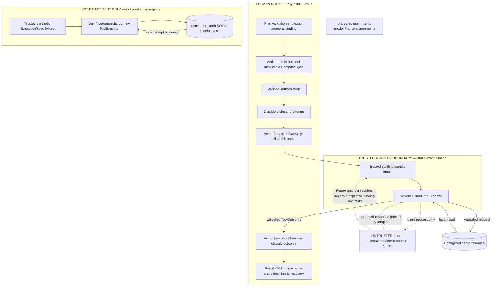

# Day 4 Prompt 1 — Competition Adapter Architecture & Contract Freeze

**Status:** design only; no adapter, tests, schema, runtime composition, or README integration is implemented here.
**Observed baseline:** `main` at `ab5991846ea9f9fcac2f3820f74451bd8028f187`; annotated `day3-final-freeze` peels to that commit.
**Decision:** a contract-level deterministic dummy implements the existing `ToolExecutor` port and is tested directly; it is not registered in the current production Action path.

## 1. Mission and Day 3 Frozen Baseline

Day 4 adds a thin, reviewed integration boundary around the existing Run + Action platform. Prompt 1 freezes a feasible contract; it does not claim implementation or general plugin support. The Day 3 rerun report records the fourth freeze attempt as `DAY3_FINAL_FREEZE_RERUN_3=PASS`, zero unresolved P0/P1 in that bounded assessment, and the local-MVP-only scope. Its verified checkpoint was `fa5080c25c4dc21e1cacc54dd2d3282fff79839e`; the later tagged commit `ab5991846ea9f9fcac2f3820f74451bd8028f187` adds the final freeze evidence. The annotated tag message also identifies the rerun-3 PASS. The earlier `docs/day3-final-freeze.md` FAIL is retained as historical evidence and is superseded by the later rerun, not silently rewritten.

Fresh baseline checks for this task found branch `main`, clean worktree, empty index, `HEAD == origin/main == live GitHub main`, and local/remote annotated tag targets equal to `ab5991846ea9f9fcac2f3820f74451bd8028f187`. Day 2 `day2-final-freeze` still resolves to `c7d3e1ee051af40c69ec33d888ecf16475a2d789`. This confirms Git provenance; it is not a new rerun of Day 3 tests.

## 2. Current Architecture Inventory

The Day 3 path remains: validated Plan → durable Run and exact approval binding → Action admission and immutable compiled specification → distinct verified authorization → durable claim/attempt → exact trusted binding resolution → one controlled executor call → safe result persistence/CAS → deterministic recovery. Run and Action are separate state machines; there is no Turn entity. The existing control-plane database is not passed to an executor.

Relevant source-first inventory: [tool executor port](../src/agentic_intent_gate/ports/tool_executor.py), [authorization port](../src/agentic_intent_gate/ports/authorization.py), [Action repository port](../src/agentic_intent_gate/ports/action_repository.py), [compiler](../src/agentic_intent_gate/application/action_compiler.py), [execution gateway](../src/agentic_intent_gate/application/action_execution.py), [Action domain](../src/agentic_intent_gate/domain/action.py), [executable registry](../src/agentic_intent_gate/adapters/executable_registry.py), [demo executor](../src/agentic_intent_gate/adapters/service_demo.py), [tool catalog](../src/agentic_intent_gate/adapters/tool_catalog.py), [capability/policy](../src/agentic_intent_gate/adapters/local_capability.py), [composition](../src/agentic_intent_gate/execution_main.py), [Day 1 Plan schema](../schemas/day1-plan.schema.json), [Day 2 freeze](day2-final-freeze.md), [Day 3 architecture](day3-action-execution-architecture-freeze.md), [Day 3 rerun](day3-final-freeze-rerun-3.md), [README](../README.md), and existing adapter/execution tests.

The Day 1 catalog is proposal/validation metadata, not executable authority. It describes `get_service_record/1`, `append_service_note/1`, and `set_maintenance_mode/1`; the Day 3 compiler admits only one supported executable shape. Existing service-demo tests exercise the real local SQLite demo sink; they do not prove arbitrary provider or competition integration. No gate DB connection or authority is passed to the executor; `DemoNoteExecutor` receives the gate DB path only during construction to reject a same-file resource path, and does not retain it.

## 3. Existing Interfaces and Exact Signatures

The immutable `ExecutionSpec` fields are `tool_name`, `tool_version`, `target`, frozen JSON `arguments`, `adapter_id`, `binding_revision`, and `execution_scope`. `from_compiled(CompiledSpec)` copies the trusted compiled values. `payload_digest()` hashes canonical identity revision `demo-note-payload-v1`, tool name/version, target, execution scope, and thawed arguments. It does **not** include `adapter_id` or `binding_revision`; the Action's separate compiled-spec digest binds its full specification. This digest is currently demo-labelled and must not be represented as a general provider identity contract.

`AttemptContext` is frozen and carries `attempt_id`, a monotonic event-loop `deadline`, and an `asyncio.Event` cancellation flag. `expired()` returns true if the flag is set or the current loop time has reached the deadline; it is cooperative, not a hard kill. `Outcome` is exactly `SUCCESS`, `CONFIRMED_FAILURE`, or `UNKNOWN_OUTCOME`. `ToolOutcome` carries `category`, `effect_key`, `execution_scope`, `target`, `payload_digest`, optional `receipt_reference`, and optional `no_effect_reason`.

The existing ports are:

```python
class ToolExecutor(Protocol):
    async def execute(
        self, spec: ExecutionSpec, effect_key: str, context: AttemptContext
    ) -> ToolOutcome: ...

class ToolRegistry(Protocol):
    bindings: tuple
    def resolve(self, spec: ExecutionSpec) -> ToolExecutor: ...
```

`ToolBinding` is a frozen record of `tool_name`, `tool_version`, `adapter_id`, `binding_revision`, `target`, and `execution_scope`. The Day 3 `ActionCompiler(validator, bindings=())` takes the validator and a zero-or-one binding tuple; `ExecutableRegistry(executor=None)` is the production resolver. `ActionExecutionGateway(repository, policy=None, registry=None, *, tool_timeout_seconds=5)` checks the compiler/registry binding tuple. Its `async execute(command, principal, *, deadline=None)` requires permission, durably claims once, resolves, calls the executor once under `asyncio.timeout_at`, classifies the outcome, and persists it; its timeout is at most five seconds. Because resolution is inside the post-claim exception boundary, a registry denial makes no adapter call but is conservatively persisted as Unknown.

`effect_key` is a server-generated UUID persisted with the Action and stable across attempts/reopen; it is not a request key, model value, or adapter-generated value. The gateway accepts SUCCESS only when all four evidence fields `(effect_key, execution_scope, target, payload_digest)` exactly match the call, the receipt is a UUID, and `no_effect_reason is None`. It accepts CONFIRMED_FAILURE only with no receipt and a whitelisted `no_effect_reason` (`INPUT_REJECTED`, `PAYLOAD_CONFLICT`, or `STORE_IDENTITY_MISMATCH`). Malformed, mismatched, exceptional, or otherwise unrecognized evidence becomes Unknown. Result messages are fixed by the core; arbitrary provider text is not returned as a receipt.

## 4. Actual Day 3 Demo-Specific Restrictions

These are source-confirmed restrictions, not a generic extension mechanism:

| Location | Observed constraint | Classification |
| --- | --- | --- |
| `adapters/executable_registry.py:ExecutableRegistry.__init__/resolve` | Accepts only exact `DemoNoteExecutor` type; resolves only an exact six-field binding match; empty registry denies. | Day 3 demo-specific restriction; default-deny is a frozen security invariant. |
| `application/action_compiler.py:ToolBinding.__post_init__` | Hard-codes `append_service_note`, version `1`, target `service-demo`; validates adapter/revision identifiers and UUID scope. | Day 3 demo-specific restriction. |
| `application/action_compiler.py:ActionCompiler.__init__/_facts` | At most one binding; only an Approved/v5 Run with exact approval proof and exactly one `SIDE_EFFECT` `append_service_note/1` step for `service-demo` compiles. | Frozen approval/whole-Plan checks plus Day 3 demo-specific executable shape. |
| `schemas/day1-plan.schema.json`, `adapters/tool_catalog.py` | Schema branches and catalog are explicit and schema-derived; no dummy or arbitrary tool. | Safe extension candidate only through a separately reviewed schema/catalog change. |
| `ports/tool_executor.py:ExecutionSpec.payload_digest` | Revision string is `demo-note-payload-v1`; digest omits adapter ID and binding revision. | Existing limitation; do not widen or reinterpret in Prompt 1. |
| `domain/action.py:Action` and `safe_result` | Persisted success message is fixed to “The demo note effect was confirmed.”; the existing Action result contract is demo-specific. | Day 3 demo-specific result presentation; full non-demo Action integration must separately revise and test this contract. |
| `adapters/local_capability.py:LocalDemoAuthorization.permit` | Requires the exact demo tool/version/target and `SIDE_EFFECT`, then exact verifier binding identity. | Day 3 demo-specific policy restriction; deny-by-default authorization is frozen. |
| `execution_main.py:compose` | Loads one private capability, provisions `DemoNoteExecutor`, builds one registry/compiler binding, then recovers before serving. | Day 3 demo-specific composition. |

The frozen invariants are exact approved-Plan binding, server-owned Action/effect identity, separate authorization and execution, durable claim/attempt, CAS-protected result, truthful Unknown, and no automatic retry/reconciliation. A future reviewed static registry is a safe extension candidate; dynamic discovery, new states/schema semantics, generic endpoint dispatch, and production RBAC/HA are deferred.

## 5. Frozen Core Versus Safe Extension Boundary

Keep Run/Action state graphs, approval proof, compiler-produced immutable `CompiledSpec`, Action/effect key ownership, capability verification, claim/attempt/recovery, `ToolExecutor` call shape, outcome categories, and result persistence unchanged. No schema migration, authorization bypass, model-direct invocation, background work, or retry is part of this contract.

Safe extension boundary: a separately reviewed adapter implementation can satisfy the existing `ToolExecutor` protocol and be called only by trusted server-side registration after exact identity resolution. The adapter can validate its own narrow arguments, speak only to its explicitly configured provider, and return evidence in the frozen envelope. The adapter cannot change Action state, claim/finish an Action, access the control-plane DB, grant permissions, or select its own identity from request/model data.

## 6. Trust and Authorization Boundary

Untrusted: user intent, model Plan and arguments, client-supplied identifiers, provider responses, and provider/transport error text. Trusted server controls: strict Plan validation, approval linkage, compiled Action identity, trusted binding selection, verified capability and policy, durable claim/attempt, `effect_key`, scope, outcome classification, and persistence. A proposal can name an allowed tool; it cannot select a Python class, module/import path, endpoint, shell command, credentials, or permission.

Provider output is untrusted even after transport succeeds. Validate its shape and correlation against the request, map it to bounded result codes, discard/redact raw errors, and issue a receipt reference only after the adapter verifies the relevant effect evidence. No provider response becomes an authorization fact.

## 7. Adapter Identity Contract

Reuse exactly the existing six-field identity: `(tool_name, tool_version, target, adapter_id, binding_revision, execution_scope)`. The compiler-visible tool/version/target must validate against the trusted catalog and executable allowlist; adapter ID, binding revision, and scope come from reviewed server configuration. All six values are immutable for a compiled Action. Safe catalog metadata may be shown to the model, but no implementation path or executable URL is exposed as authority.

Review a binding through code/config review, exact input/output and side-effect analysis, authorization-scope review, timeout/error/receipt tests, and an explicit acceptance decision. Retirement removes the binding from active dispatch; it does not rewrite retained Actions. A changed revision is a different identity and old Actions fail closed on dispatch. Keep retained identity attributable in the Action record/evidence; historical visibility remains a scope check and is not permission to execute a retired binding. No new global identity system is proposed.

## 8. Trusted Registration Strategy

For any later production adapter, use a static, explicit, reviewed construction site and an exact six-field match. The trusted composition owner instantiates only reviewed adapter classes and registers their immutable binding records. Reject unknown/missing/retired bindings, any field/revision/scope mismatch, duplicate identity, duplicate binding key, invalid adapter object, or unsupported arguments before provider I/O. Empty or ambiguous registration denies. Registration changes require tests and a new reviewed revision.

Never use model/client data for imports, Python entry points, class names, shell, remote code, generic callables, or unrestricted URLs. Prompt 1 does not implement a registry or change the current registry. The dummy is deliberately outside it.

## 9. Core/Adapter Responsibility Matrix

| Core owns | Adapter owns, within its reviewed binding |
| --- | --- |
| Plan validation and exact approval identity | Provider-specific request construction and strict provider argument mapping |
| Verified authorization and binding selection | Provider-specific response parsing/correlation |
| Durable Action/effect key, claim and attempt | Provider-supported idempotency key usage and its documented limits |
| Action state/CAS, result persistence and recovery | Evidence-backed receipt creation and uncertainty classification |
| Unknown prevents automatic redispatch | Provider timeout configuration and safe error normalization |

Core guarantees a single authorized dispatch attempt per durable claim and truthful persisted state under its verified local contract. It cannot guarantee that a remote service did nothing after a timeout, nor supply provider idempotency/receipt semantics. Those require provider evidence and adapter-specific tests. No adapter may claim universal exactly-once behavior.

## 10. Dummy Adapter Choice and Rationale

Choose **Option A**: a direct contract-level dummy implementing `ToolExecutor`, exercised with trusted synthetic `ExecutionSpec` fixtures. It uses the frozen port and result classifier but is not added to `ExecutableRegistry`, `ActionCompiler`, `tool_catalog`, capability policy, `execution_main.compose`, or the browser Action route. This is the smallest safe implementation and preserves Day 3 production behavior. It meets the minimum Day 4 dummy-plus-contract-tests goal without implying a live Action integration.

The dummy performs one deterministic local record operation through an injected, test-owned receipt-store port. Prompt 3 supplies a real SQLite implementation under pytest `tmp_path`; the adapter itself accepts no filesystem path and has no ambient filesystem/network/shell access. That store proves only its own local atomic record + receipt behavior. It is not a provider guarantee.

**Option B considered, not selected.** To dispatch a dummy through the full Action path would require changes at least to `ToolBinding.__post_init__` and `ActionCompiler._facts`/binding selection; schema and `tool_catalog.py` to admit its Plan and target; `ExecutableRegistry` to statically register and resolve both reviewed classes; `LocalDemoAuthorization.permit` to authorize only the exact dummy binding; `domain/action.py` to remove or safely generalize the demo-specific success message; and possibly `execution_main.compose` plus its explicit config/tests. Each change would need allowlist, identity-mismatch, duplicate-registration, authorization-denial, old-Action/reopen compatibility and real HTTP/SQLite/browser tests. `ExecutionSpec.payload_digest` also has a demo-specific revision and omits adapter/revision; changing it would alter downstream same-key payload comparisons and needs a compatibility design. This is materially wider and is not authorized by Prompt 1. No schema migration or production registration is needed for Option A.

## 11. Exact Dummy Adapter Input/Output

Prompt 2 should add one `DeterministicDummyExecutor` implementing the existing port. Its trusted constructor receives a valid UUID execution scope and a `DummyReceiptStore` protocol; it does not accept a path, endpoint, credential, import name, or model-controlled binding. The test fixture creates a frozen `ExecutionSpec` with exact identity `dummy_record/1`, target `test-local-dummy`, adapter ID `day4-dummy`, binding revision `dummy-v1`, and that fixture's trusted scope. These values are synthetic and not compiler/catalog supported.

Accepted arguments are exactly `{"record": <string>}`: nonempty, at most 256 UTF-8 bytes, and total canonical JSON at most 1024 bytes. Treat content as inert data (including adversarial-looking text); never parse it as a command, SQL fragment, URL, or path. Reject extra/missing keys, wrong types, invalid identity, invalid effect/attempt UUID, oversized input, or wrong scope before store dispatch.

The adapter validates all six identity fields, arguments and context, then computes an adapter-local SHA-256 payload identity over canonical JSON with revision `dummy-record-v1`, the complete six-field binding, and validated arguments. This supplements—not changes—the frozen `ExecutionSpec.payload_digest()`, which must be echoed in `ToolOutcome` for the existing classifier. `effect_key` is passed in by trusted caller and never generated/replaced by the adapter.

The injected store exposes one narrow atomic operation, conceptually `apply_once(effect_key, adapter_payload_digest, execution_scope, record)`. It returns one of: `CREATED`/`REPLAYED` with a canonical UUID receipt; `CONFLICT`; or an explicit pre-effect `REJECTED`/`IDENTITY_MISMATCH`. The adapter maps a verified receipt to SUCCESS with exact effect key/scope/target/frozen payload digest and no failure reason. It maps a proved pre-effect rejection/conflict/identity mismatch to CONFIRMED_FAILURE with no receipt and only a reason accepted by the frozen classifier. Store exceptions, ambiguous commit/cleanup, malformed receipt, cancellation or expiry map to UNKNOWN; no exception text is returned. A cancelled task is not swallowed and the gateway remains responsible for persisting Unknown.

The test-owned SQLite store persists binding/scope metadata, local record and receipt in a separate schema/file; validates metadata on every call; uses `BEGIN IMMEDIATE`, unique `effect_key`, parameterized SQL, and an atomic record+receipt commit. Same key/same adapter digest returns and verifies the prior receipt after reopen; same key/different digest rejects without changing rows. Commit acknowledgement uncertainty is Unknown. No Day 3 DB/schema is reused or modified.

## 12. Result and Evidence Classification

| Situation | Adapter outcome | Frozen gateway result |
| --- | --- | --- |
| Valid, verified local receipt; exact metadata | SUCCESS with UUID receipt, no reason | Succeeded |
| Invalid input or a store-proven pre-effect rejection | CONFIRMED_FAILURE, null receipt, whitelisted no-effect reason | Failed |
| Same effect key with different retained adapter digest | CONFIRMED_FAILURE / `PAYLOAD_CONFLICT`, null receipt | Failed |
| Unknown binding at production registry | No executor call; registry denies after claim | No dispatch; gateway conservatively persists Unknown |
| Deadline/cancellation, store exception, commit/close uncertainty, malformed receipt, forged or mismatched evidence | UNKNOWN_OUTCOME or malformed evidence | Unknown; never infer failure from transport loss |

`SUCCESS` requires a UUID receipt validated by the adapter and the gateway. `CONFIRMED_FAILURE` requires affirmative evidence that no effect occurred and an existing whitelisted reason; an arbitrary new reason becomes Unknown. Provider rejection is safe failure only when the adapter can prove it was rejected before effect. Error strings and provider receipt bodies are never copied into public Action results.

## 13. Idempotency and Receipt Semantics

The core creates one stable server `effect_key` with the Action, persists it, and scopes execution identity. The adapter store owns the dummy's separate retained receipt and adapter-specific payload digest. Key reuse with identical binding/scope/payload returns the same verified receipt. Key reuse with a different binding or payload is a conflict before new work. Reopening the test-owned SQLite store must preserve both facts.

This demonstrates atomic local dummy behavior only. Core Action claim idempotency is not downstream idempotency. A remote provider must document whether it accepts the stable key, the exact key scope/retention window, payload-conflict behavior, receipt lookup semantics, and commit ambiguity. If it cannot prove this, classify the risk before integration; do not promise exactly once, retry Unknown, or silently issue a new key. No automatic retry/reconciliation is added.

## 14. Timeout and Cancellation

The gateway applies `asyncio.timeout_at` to the minimum of its configured (maximum five-second) tool timeout and any caller deadline, sets the cooperative cancellation event in `finally`, and maps timeout/adapter exceptions to Unknown before result persistence. The adapter checks `context.expired()` before dispatch and after store return; expiry is conservatively Unknown. Cancellation is not proof of no effect. A task cancellation is persisted as Unknown by the gateway and then re-raised; no detached task or helper is allowed.

The SQLite dummy store is synchronous and can exceed a cooperative deadline; an asyncio timeout is not a hard kill of a blocking call. If a store commit succeeds but acknowledgement/cleanup is lost, return Unknown; retained same-key evidence may be inspected only by a separately authorized future reconciliation design, not automatic Prompt 2–4 redispatch. Failure to persist the core result is likewise not proof that the local effect did not commit. No background workers, hard-kill claim, automatic retry, or generic reconciliation is proposed.

## 15. Security Threat Model

Threats include model/client binding substitution, wrong scope/revision, argument injection, oversized data, malicious record text, forged category/receipt/metadata, secret-bearing provider errors, duplicate/concurrent calls, replay after process restart, malformed local store identity, cancellation races, and resource leaks. Controls are exact immutable binding checks, strict bounds, inert data handling, test-owned scoped store, parameterized SQL, unique key and atomic receipt, exact result-envelope validation, conservative Unknown, no ambient credentials, and explicit close/rollback.

The dummy does not sandbox a malicious Python implementation; trusted adapter code/configuration remain in the host trust boundary. Production auth/RBAC, hostile-host protection, multi-worker HA and external-service guarantees are not established by these tests.

## 16. Contract Test Matrix

Prompt 3 should implement every row below. Store state means the isolated test-owned SQLite file; “none” means no dummy record/receipt mutation.

| Case | Expected behavior | Classification | Side-effect expectation | Test type / boundary |
| --- | --- | --- | --- | --- |
| Valid binding | One verified receipt; exact evidence envelope | SUCCESS | One atomic record + receipt | Direct adapter; identity/store |
| Wrong tool name | Direct dummy rejects before store; production registry denies after claim | Direct: CONFIRMED_FAILURE / `INPUT_REJECTED`; gateway path: Unknown | None | Unit; adapter/registry boundary |
| Wrong tool version | Direct dummy rejects before store; production registry denies after claim | Direct: CONFIRMED_FAILURE / `INPUT_REJECTED`; gateway path: Unknown | None | Unit; exact version |
| Wrong target | Direct dummy rejects before store; production registry denies after claim | Direct: CONFIRMED_FAILURE / `INPUT_REJECTED`; gateway path: Unknown | None | Unit; target binding |
| Wrong adapter_id | Direct dummy rejects before store; production registry denies after claim | Direct: CONFIRMED_FAILURE / `INPUT_REJECTED`; gateway path: Unknown | None | Unit; implementation identity |
| Wrong binding_revision | Direct dummy rejects before store; production registry denies after claim | Direct: CONFIRMED_FAILURE / `INPUT_REJECTED`; gateway path: Unknown | None | Unit; revision binding |
| Wrong execution_scope | Direct dummy rejects before store; production registry denies after claim | Direct: CONFIRMED_FAILURE / `INPUT_REJECTED`; gateway path: Unknown | None | Unit; tenant/resource scope |
| Invalid arguments | Exact-key/type/length validation rejects | CONFIRMED_FAILURE / `INPUT_REJECTED` | None | Unit; parser/bounds |
| Oversized arguments | Reject at field or canonical byte bound | CONFIRMED_FAILURE / `INPUT_REJECTED` | None | Unit; resource bound |
| Malicious text | Treat accepted bounded string as inert data | SUCCESS only if literal stored safely | One literal row; no command/network | Unit; data-vs-code boundary |
| Expired deadline | Do not dispatch (or report Unknown if expiry races dispatch) | UNKNOWN_OUTCOME | None before dispatch; otherwise no success claim | Unit; cooperative deadline |
| Cancellation | No swallowed cancellation or unsupported success | UNKNOWN_OUTCOME at gateway | None before dispatch; in-flight effect may be uncertain | Async unit; cancellation boundary |
| Confirmed provider/store rejection | Map only explicit proof of pre-effect rejection | CONFIRMED_FAILURE / whitelisted reason | None | Unit; outcome evidence |
| Unknown provider/store outcome | Exception/ambiguous commit maps to Unknown | UNKNOWN_OUTCOME | May be none or committed; inspect store only in assertion | Fault-injection unit; uncertainty boundary |
| Duplicate effect_key | Same binding/payload returns retained same receipt after reopen | SUCCESS replay | Exactly one local record/receipt | SQLite integration; retained state |
| Conflicting payload | Same key/different adapter digest conflicts | CONFIRMED_FAILURE / `PAYLOAD_CONFLICT` | No additional mutation | SQLite integration; key/payload binding |
| Malformed receipt | Adapter/gateway refuses malformed UUID evidence | UNKNOWN_OUTCOME | No new accepted result | Unit; receipt validation |
| Forged SUCCESS | Wrong key/scope/target/digest, receipt or reason fails classification | UNKNOWN_OUTCOME | No trusted success persisted | Gateway classifier unit |
| Forged CONFIRMED_FAILURE | Missing/unrecognized no-effect proof fails classification | UNKNOWN_OUTCOME | No false confirmed failure | Gateway classifier unit |
| Secret-bearing provider error text | Normalize/discard; never expose raw text | UNKNOWN_OUTCOME or safe mapped result | No extra effect | Unit; error redaction |
| Concurrent invocation | Store uniqueness/transaction serializes same key | One receipt, all equivalent replay or safe conflict | One local record/receipt | Threaded SQLite integration; atomicity |
| Resource cleanup | Connection closes; transaction rolls back when safe | Preserve primary classification; cleanup uncertainty is Unknown | No leaked connection/partial record | Fault-injection unit; resource lifecycle |
| No implicit retry | One call per explicit invocation; gateway does not replay Unknown | Unknown remains Unknown | No automatic second dispatch | Gateway/adaptor integration; dispatch boundary |

Wrong identity cases may be denied earlier by a future trusted registry, so tests must assert “no store dispatch”; they must not require production registration to test the adapter directly. Prompt 1 runs no tests.

## 17. Proposed Source Change Allowlist

Only the two Prompt 1 documentation/evidence files are authorized now. Proposed later paths are plans, not current authorization:

| Path | Purpose / owner prompt | Class | Allowed later | Explicitly prohibited |
| --- | --- | --- | --- | --- |
| `src/agentic_intent_gate/adapters/dummy_executor.py` | Implement direct `ToolExecutor`; Prompt 2 | Production adapter | Strict validation, injected store protocol, safe outcomes | Registry/compiler/catalog/composition changes; paths, network, shell, credentials |
| `tests/test_dummy_adapter_contract.py` | Test matrix and isolated SQLite receipt store | Test; Prompt 3 | `tmp_path`-owned schema/DB, fault injection, reopen/concurrency assertions | Day 3 SQLite schemas, user DBs, live provider/credentials |
| `README.md` | Add accurate frozen-core/adapter diagram and scope note | Documentation; Prompt 4 | One bounded diagram and explicit “dummy contract-only” label | Claiming live Action/browser/competition integration |
| `tests/test_dummy_adapter_e2e.py` | Test the direct adapter + real isolated receipt store across reopen | Test; Prompt 4 | Local deterministic boundary E2E, no HTTP/browser claim | Production composition or browser Action E2E claim |
| `docs/day4-final-freeze.md` | Final evidence summary/gates | Documentation; Prompt 5 | Record exact scoped verification | Rewrite historical Day 1–3 evidence |
| `docs/evidence/day4-final-freeze.json` | Structured final evidence | Evidence; Prompt 5 | Actual measured gates and hashes | Fabricated or inferred observations |

No dependency is needed. No changes to `ports/`, domain, compiler, schemas, authorization, repository, Action state, Day 3 DB, execution composition, UI, or existing tests are required for selected Option A. If a later request changes that scope to full Action registration, stop for a separate explicit review/allowlist.

## 18. Day 4 Prompts 2–5 Implementation Plan

**Prompt 2:** add only `dummy_executor.py`; implement exact identity/argument validation, adapter-local canonical payload digest, injected `DummyReceiptStore`, conservative error/timeout outcomes, and no runtime registration. The implementation is exercised only with trusted synthetic specs until Prompt 3 adds tests.

**Prompt 3:** add `test_dummy_adapter_contract.py` with all 23 matrix categories, exact outcome-classifier tests, a test-owned SQLite store in pytest `tmp_path`, restart/reopen, conflicting-key, concurrency, rollback/commit ambiguity, secret redaction, cleanup, and proof of one dispatch. Do not alter Day 3 tests or schemas.

**Prompt 4:** add the README diagram and separately labelled direct-boundary E2E test (`test_dummy_adapter_e2e.py`) that creates a synthetic spec, runs the real dummy against the isolated SQLite store, reopens it, and verifies one receipt. It is local adapter evidence—not a full Action, HTTP, browser, real provider, or competition E2E. Any product demand for a live Action route requires separately approved Option B work.

**Prompt 5:** audit exact diff/allowlist, run the agreed deterministic tests and relevant regression, validate structured evidence, secret scan, and confirm clean resource/process state. Report `PASS`, `NOT RUN`, `BLOCKED`, and `PARTIAL` separately; no tag/push/release unless explicitly authorized by that prompt. Do not infer external/HA guarantees.

## 19. Mermaid Architecture Diagram



The current production path contains only the reviewed demo executor. The lower test-only lane is a direct port contract test; it is intentionally not connected to the production claim/registry path. The dashed future-provider relationship is not implemented functionality.

## 20. Compatibility with Day 3 Freeze

Selected Option A adds no production registration and leaves compiler, registry, catalog, capability policy, `execution_main.compose`, Plan/approval schemas, state machine, persistence, gateway, UI, and Day 3 evidence unchanged. Existing Day 3 behavior and default-deny behavior remain intact. The dummy returns the existing `ToolOutcome` shape and uses the current classifier contract. Its adapter-local digest compensates for—but does not modify—the demo-labelled `ExecutionSpec.payload_digest`.

Day 3's latest accepted report is the fourth-attempt rerun-3 PASS; prior FAIL reports remain historical. This design neither repeats those gates nor upgrades the local MVP into production/security/HA readiness.

## 21. Known Limitations

The dummy is not admitted through a Plan, approval, Action, current registry, HTTP API, browser, or `execution_main.compose`. The frozen Action success text is demo-note-specific, so a real non-demo Action binding also needs a separately reviewed safe result-message contract. No real provider, competition API, MCP, cloud, authenticated human consent/RBAC, multi-worker HA, hostile-plugin sandbox, power-loss qualification, or universal exactly-once behavior is tested. `ExecutionSpec.payload_digest` retains its demo-labelled identity and excludes adapter/revision; a generic migration requires a separately reviewed compatibility plan. SQLite behind the async executor is cooperative and not forcibly cancellable. Local dummy idempotency proves only the test-owned store's atomic transaction.

## 22. P0/P1/P2 Risk Review

**P0:** none identified in this bounded contract review; this is not a full security certification.
**P1:** none left unresolved at the contract boundary. The latest Day 3 rerun evidence records zero unresolved P0/P1; Prompt 1 made no product-code claim or revalidation.
**P2 / deferred:** full Action registration; generic payload identity revision; remote-provider idempotency/receipt semantics; production identity/RBAC; HA/distributed execution; hard cancellation; automatic retry/reconciliation; cloud/MCP/Qloo; browser/competition E2E. These remain explicitly out of scope, not hidden acceptance failures.

## 23. Contract Freeze Decision

The existing `ToolExecutor` port is sufficient for a bounded, deterministic, directly tested dummy. Static production registration and full Action admission are intentionally deferred. Source restrictions are understood and preserved; the contract is internally consistent with current result validation, identity, cancellation, and local receipt semantics. Contract readiness does not imply the dummy has been implemented or that a live competition integration exists.

```text
DAY4_PROMPT1_ADAPTER_CONTRACT_FREEZE=PASS
DAY4_DUMMY_ADAPTER_IMPLEMENTATION_READY=YES
DAY3_FROZEN_CORE_UNCHANGED=YES
```
