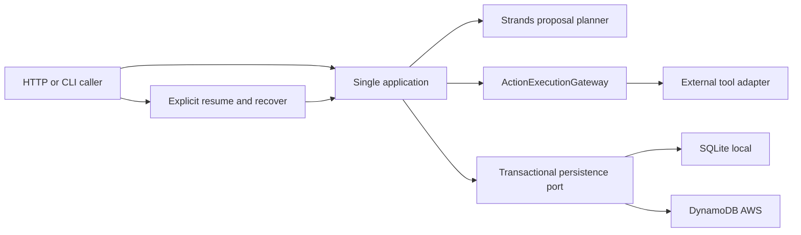
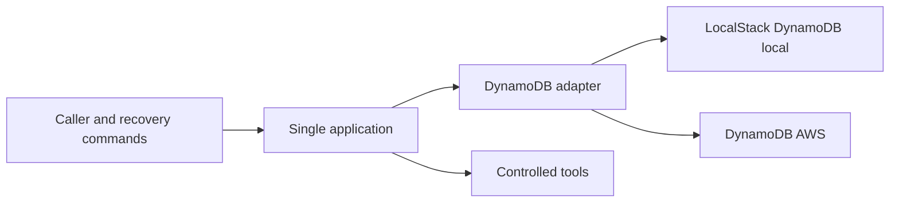
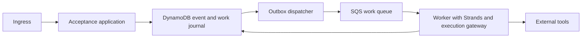

# AgenticIntentGate — architecture options

**OUR DESIGN DECISION — Stage 1, 2026-10-03.** All options are proposed designs. None has been implemented or benchmarked. [Research gaps](../research/stage0/twilio-gap-register.md) motivate explicit recovery and durable ownership.

## Option 1 — one application, bounded synchronous work, SQLite/DynamoDB

Ingress durably accepts a Turn, then attempts work within a request budget. Waiting approval or unfinished work returns a stored snapshot. Explicit authorized commands drive progress later. There is no hidden background task after an HTTP response.

This meets safety and reconstruction requirements with one deployable application and a small transaction port. It sacrifices unattended recovery and reliable time-to-completion. Two storage adapters need one behavioral contract suite; SQLite results cannot prove DynamoDB behavior. Bedrock/AgentCore remain adapters rather than durable orchestration.

## Option 2 — same request model, DynamoDB in local and AWS modes

One persistence adapter reduces mapping differences and exercises transaction API serialization early. Mandatory container/emulator startup increases local setup and failure-debugging burden. Emulator success still cannot prove IAM, throttling, service consistency, or managed durability. It solves a real storage API parity concern but is unnecessary for every deterministic domain test. Its benefit is retained as an optional, targeted adapter-validation lane under Option 1.

## Option 3 — acknowledge and enqueue, separate worker

This gives automatic progress despite short ingress timeouts and decouples model latency. It needs a transactionally recorded work/outbox item because a database write plus queue send is not atomic. Queue redelivery still needs Action ownership and UNKNOWN handling. A dispatcher, worker lifecycle, visibility settings, DLQ policy, and a local queue simulator add operational burden. It would solve unattended liveness, which the small operator-driven MVP does not require. A queue cannot solve uncertain external effects. This is a valid future option if automatic progress becomes an accepted requirement.

## Comparison

| Requirement / tradeoff | Option 1 | Option 2 | Option 3 |
| --- | --- | --- | --- |
| Duplicate/claim safety | Domain transactions, two mappings | Same domain transactions, one API mapping | Same transactions plus queue redelivery |
| Restart | Explicit recover/resume from journal | Same | Worker/outbox redelivery, still reconcile UNKNOWN |
| Local testability | No cloud emulator by default | Emulator required for persistence | Multiple local moving parts |
| AWS portability | DynamoDB adapter parity must be proven | Fewer API differences; cloud still unverified | More AWS boundaries and operational contracts |
| Failure semantics | Request timeout exposes incomplete stored state | Same | Adds enqueue/visibility/DLQ failure windows |
| Complexity | Small application, two small storage adapters | Small application, mandatory emulator | Highest component and liveness burden |
| Cost | On-demand request execution, no scheduler | Same cloud cost; more local setup | More services and invocations |
| Portfolio relevance | Core intent/effect reliability is visible | Highlights AWS API mapping | Highlights operations beyond current MVP |
| Divergence from reference | Durable business journal; no channel-owned effects | Same plus mandatory AWS storage emulation | Adds durable work transport as well |

No numeric ranking is used. **Selected: Option 1.** It satisfies durability, conditional ownership, approval, and recovery with a simpler default local environment. Unattended completion is explicitly outside the frozen guarantee. Switching to asynchronous work later requires a new ADR and liveness tests.

## Storage decision inside Option 1

| Dimension | A: SQLite local + DynamoDB AWS | B: DynamoDB + LocalStack everywhere | C: SQLite everywhere |
| --- | --- | --- | --- |
| Setup | Python standard-library storage locally | Container/emulator required | Smallest local setup |
| Conditional writes | SQL predicates/uniqueness locally; DynamoDB conditions remotely | DynamoDB conditions in both | SQL predicates only |
| Optimistic concurrency | Version checked inside each adapter's transaction | Same DynamoDB contract | Single local database |
| Atomicity | Named bounded domain transaction groups | Same groups using service API | Local transactions; no safe shared AgentCore file assumption |
| Failure testing | Real disk/subprocess tests; adapter parity lane later | Emulator faults plus app faults | Local only |
| AWS portability | Explicit adapter implementation | API parity advantage | AgentCore scratch/session files cannot serve as shared authoritative database |
| Dependencies | SQLite built-in; boto3 AWS only | boto3 and emulator/container setup locally | Built-in, but AWS durability remains unsolved |
| Portfolio value | Clear domain/cloud separation | Clear AWS integration emphasis | Fails the selected restart/multi-runtime scope |
| Cost | No local service; on-demand cloud tables | Same cloud runtime cost | Durable shared filesystem/host would introduce new cost and responsibilities |

**Select A.** C is genuinely simpler for a local-only tool, but does not meet the intended shared cloud execution boundary. No PostgreSQL, Redis, Kafka, or generic repository ORM is needed.

Adapter feasibility: SQLite supports one writer and explicit write transactions; DynamoDB supports atomic conditional transaction groups. These facts support the design, not adapter correctness. [SQLite transactions](https://sqlite.org/lang_transaction.html), [DynamoDB transaction API](https://docs.aws.amazon.com/amazondynamodb/latest/APIReference/API_TransactWriteItems.html).

## Complexity challenge

| Selected component | Invariant or explicit requirement lost if removed |
| --- | --- |
| Single Python application | No ingress, planning, policy, or execution coordinator |
| Durable storage | Event identity, approval, ownership, and recovery lost across process restart |
| Strands Agent + Model boundary | Real framework tool-calling/model adaptation requirement lost |
| ActionExecutionGateway | No single enforceable boundary between proposal and write |
| Approval API/CLI in the same app | No authorized human decision and resume path |
| Delivery adapter/journal in the same app | Cannot distinguish computed result from accepted outbound response |
| Independent demo ledger | Cannot observe a side effect separately from gate status |
| AgentCore later | Intended managed runtime/deployment validation requirement lost; safety still belongs to storage |
| Bedrock later | Intended AWS inference integration requirement lost |
| IAM later | No restricted AWS caller/resource access |
| CloudWatch later | No selected cloud log/metric evidence collection path |

No separate broker, dispatcher, scheduler, approval service, audit service, or UI is selected. Public verification keys are configuration; Secrets Manager is not required by the selected tools. Packaging storage is a deployment artifact dependency, not another business service.
