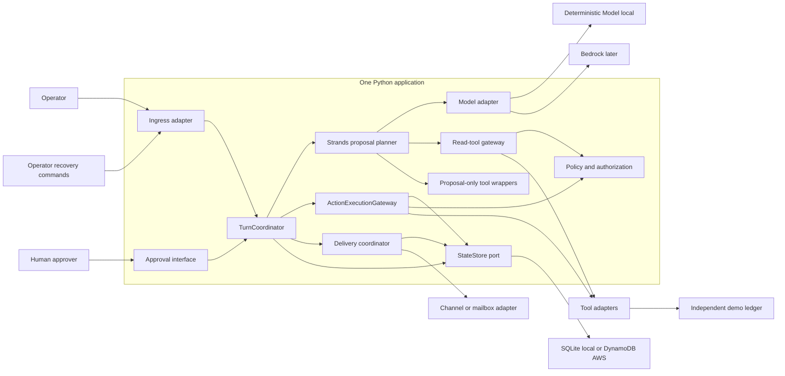

# AgenticIntentGate — final architecture

**Scope update — 2026-10-03:** this is the later durable execution architecture. The current local planning preview is defined by [ADR-011](adr/ADR-011-day1-planning-preview.md) and the [Day 1 freeze](day1-architecture-freeze.md); it uses no durable Turn, tools, or execution gateway. The no-frontend/full-Strands requirements below belong to this later reliability MVP.

**OUR DESIGN DECISION — Stage 1 architecture frozen / PASS, 2026-10-03.** Nothing in this document is an implementation claim. Normative details live in [contracts](stage1-contracts.md), [state machines](stage1-state-machine.md), and [atomic operations](stage1-idempotency-and-concurrency.md).

## Context and responsibility

An authenticated operator submits text with a stable logical event identity. A Strands Agent reads allowed operational context and proposes tools. The application validates and freezes the proposal plan, obtains required approvals, executes Actions under storage ownership, reconciles uncertain outcomes, and records a final response Delivery.



## Components and ports

| Component / port | Owns | Boundary and exclusions |
| --- | --- | --- |
| Ingress adapter | Authentication, envelope limits, provider event normalization, delivery attempt identity | Passes domain DTOs; never forwards caller-supplied actor privileges |
| TurnCoordinator | Acceptance, planning claim, plan commit, Action ordering, finalization, resume/recover commands | Bounded application use cases; no workflow DSL or general scheduler |
| Strands planner | Real Agent loop, read wrappers, proposal-only wrappers, collected transcript/proposals | Cannot access mutation adapters or execute model-suggested writes |
| Model adapter | Strands Model interface, provider events/configuration | Fake contract model, optional local provider, BedrockModel; no provider DTO in core |
| Read-tool gateway | Schema and resource authorization before read I/O | Results journaled in committed planning snapshot; retries are read-only |
| ActionExecutionGateway | Immutable proposal check, authorization/policy, approval, idempotency key, conditional claim, adapter invocation, attempt result, UNKNOWN/reconciliation | No prompting, new arguments, business scenario routing, scheduling, or automatic compensation |
| StateStore | Named atomic domain operations, strong reads, versions, receipts, attempts, audit | No generic CRUD composition pretending to be a transaction |
| Approval interface | Listing pending proposals, authorized decision submission | Same application via HTTP/CLI; no separate UI/service |
| Delivery interface | Immutable final summary, conditional send ownership, receipt and outcome | Cannot change Action truth or rerun an Action |
| Clock and ID helpers | UTC timestamps, injected deterministic clock, namespace/ID creation | Small functions/ports for expiry and replay tests; no infrastructure service |

These boundaries exist either for local/AWS modes or to isolate critical I/O. Modules are not independently deployed services.

## Execution flow and commit barrier

```mermaid
sequenceDiagram
  participant C as Caller
  participant T as TurnCoordinator
  participant S as StateStore
  participant A as Strands planner
  participant G as ActionExecutionGateway
  participant X as External tool
  participant H as Approver
  participant D as Delivery adapter
  C->>T: Authenticated inbound message + event identity
  T->>S: accept_inbound transaction
  S-->>T: One Turn or existing duplicate mapping
  alt Newly accepted and time budget available
    T->>S: claim_turn
    T->>A: Fresh Agent with committed history
    A->>A: Authorized reads; collect proposal-only tool calls
    A-->>T: Complete bounded planning snapshot
    T->>S: commit_plan atomically: snapshot + ToolCalls + PROPOSED Actions
    T->>S: prepare_action: READY or Approval + WAITING_APPROVAL
  end
  opt Required approval
    T-->>C: Stored WAITING_APPROVAL snapshot
    H->>T: Authorized decision for exact proposal hash
    T->>S: decide_approval transaction
  end
  opt All approvals valid and explicit processing request owns Turn
    T->>G: Execute next fixed Action
    G->>S: claim_action_execution conditionally
    G->>X: I/O with stable downstream key
    X-->>G: Confirmed result or uncertainty
    G->>S: record_attempt_outcome with claim token
  end
  opt Turn can finalize
    T->>S: finalize_turn + PENDING Delivery + release conversation slot
    T->>D: Attempt immutable final summary
    D-->>T: Provider receipt or failure/UNKNOWN
  end
  T-->>C: Snapshot with separate Turn, Action and Delivery states
```

All side-effect tools exposed to Strands are **proposal-only wrappers**. They collect validated intents and return `PROPOSAL_ONLY`, explicitly indicating no execution. Read tools perform authorized read I/O. Planning runs to a bounded completion and the coordinator commits its snapshot plus every side-effect Action atomically. No Action claim is legal before `plan_committed_at` exists. A model crash before that commit may cause replanning, but cannot have performed a write.

Once committed, the plan is immutable and the model is not reinvoked for that Turn. Human approval and recovery operate directly on stored Actions, using deterministic final summaries. This removes dependence on an SDK's suspended loop or a model reproducing the same tool-call ID. A future result-dependent agent loop needs a new architecture decision.

The Agent may emit unsafe or false wording. Its final text is retained as planning evidence, never used to declare an Action succeeded or as the final operational status. Final delivery text is generated from stored outcomes. A read-only Turn may include its bounded validated read result in that summary.

## Synchronous request semantics

Selected: **bounded synchronous processing**, with a 30-second application request budget. A command attempts available work and returns by its budget; it must not start an I/O operation that cannot fit its adapter deadline plus a persistence reserve. A durable acceptance transaction occurs before planning. HTTP transport status is not the business outcome.

Local POST responses: 200 for a terminal Turn snapshot, including FAILED; 202 for an accepted nonterminal snapshot. Unaccepted schema/auth failures are 400/401/403; a busy same-conversation new event is 409 and creates no event/Turn; storage unavailable before acceptance is 503. Missing stable event key is 428. A snapshot has `ingress_status=INGRESS_ACCEPTED`, `turn_state`, individual `action_states`, and `delivery_state`; no combined `success=true`.

Client timeout/disconnect may hide the acceptance response or an ongoing bounded attempt. The caller queries or redelivers the same event; a duplicate returns the original Turn without automatic model/write execution. Authorized `resume` or `recover` drives remaining work. There is no unattended completion or automatic expiry SLA. Retry times are durable eligibility times and enforced by commands, not a scheduler.

## Approval and execution

Every required approval is recorded before **any** side-effect Action in the Turn is claimed. Distinct Actions execute sequentially in immutable plan order. All plan approvals must still be usable at every new Action claim, including a no-additional-approval Action: the plan has one consent-valid execution window. A rejected/expired approval fails the Turn and cancels unexecuted siblings. Authorization is rechecked at execution; approval cannot grant permissions. Approvals expire after 15 minutes, and the Action must be claimed before expiry. An effect already claimed while approval was valid is not retrospectively revoked by expiry.

If a later Action fails after an earlier success, the Turn becomes FAILED with partial results; no whole-turn rollback is promised. If an effect is uncertain, the Turn stays WAITING_RECONCILIATION and retains its conversation slot. An unresolved effect cannot be cancelled and mislabeled as absent.

## Local and AWS modes

Local: one HTTP/CLI application, real Strands framework, deterministic Model, SQLite WAL/FULL state store, independent durable tool fixture and mailbox fixture. Test fixture services are evidence instruments, not production microservices. No AWS/Twilio dependency is required for default correctness tests.

AWS later: the same application/core behind AgentCore HTTP `/invocations`, operation envelopes for status/approval/resume/recovery, BedrockModel, DynamoDB state table, independent DynamoDB demo ledger/mailbox table, IAM, and CloudWatch. A trusted CLI calls the runtime with SigV4 and an application actor assertion. No public webhook or Lambda is required. Local routes map to operation names because the managed runtime endpoint is not assumed to expose arbitrary local REST routes. [AgentCore protocol contract](https://docs.aws.amazon.com/bedrock-agentcore/latest/devguide/runtime-service-contract.html).

AgentCore owns hosting and invocation. It owns neither event uniqueness, business ownership, approval, nor authoritative history. The runtime recreates Agents from committed conversation history and Turn snapshots on demand; FileSessionManager is not selected for the gate. Runtime session IDs are routing values generated from trusted conversation mapping, not an authorization mechanism. AWS documents that applications must enforce user/session binding; our adapter enforces conversation membership independently. [Runtime session security](https://docs.aws.amazon.com/bedrock-agentcore/latest/devguide/runtime-instances-security.html).

The model strategy retains one real Strands Agent and swaps the Model provider. A deterministic custom Model supplies scripted text/tool events and failures; optional local model output is exploratory; Bedrock later validates real inference only. The official [custom provider interface](https://strandsagents.com/docs/user-guide/sdk/model-providers/custom_model_provider/) supports this boundary. Exact SDK/package versions will be independently pinned in Stage 2, without importing the reference environment or its compatibility alias.

## Recovery and durability

Only committed storage facts are authoritative. Recovery loads the event mapping, conversation slot, Turn, immutable plan, Actions, approvals, attempts, and Delivery. It fences stale planning owners with conditional versions. An Action claim has **no automatically expiring lease**; EXECUTING after owner loss becomes UNKNOWN and is never automatically reclaimed for another write.

Read-only reconciliation can establish a provider receipt. Re-execution from UNKNOWN requires both safe provider semantics and proof that the prior executor cannot send another request; a timeout or missing lookup result is insufficient. Missing evidence leaves UNKNOWN visible. The [failure matrix](stage1-failure-model.md) defines all crash windows and restart choices.

## Deliberate exclusions

No durable task replay, free-form workflow engine, queue, automatic scheduler, real voice, RAG, MCP, LangGraph, Temporal, Kubernetes, frontend, third-party delivery guarantee, or universal exactly-once property. The [local/cloud boundary](stage1-local-cloud-boundary.md) lists excluded AWS services and the eventual packaging path.
