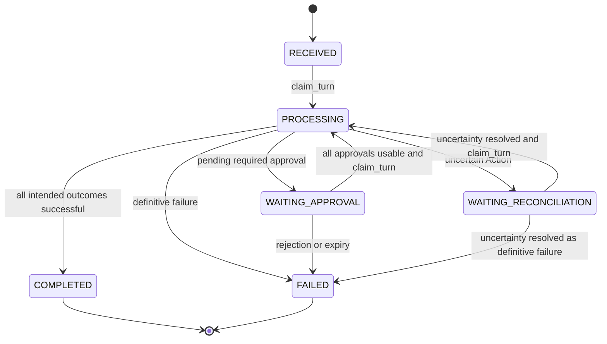
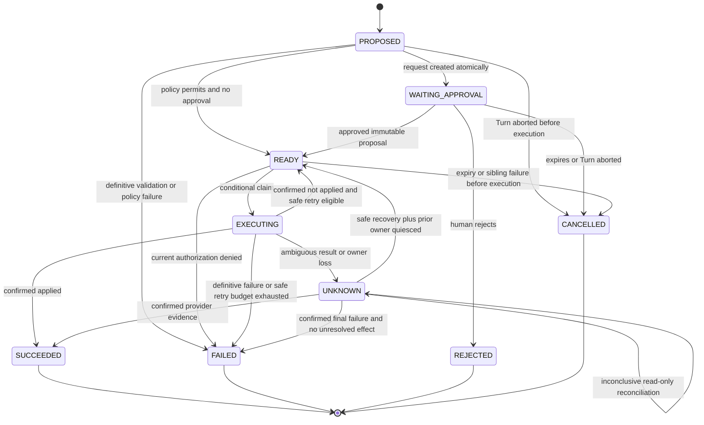
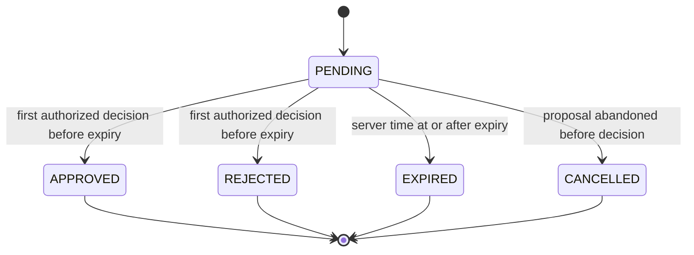
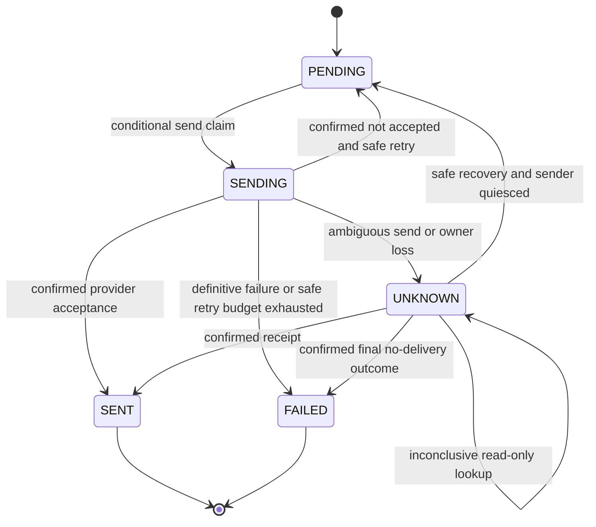

# AgenticIntentGate — durable state machines

**OUR DESIGN DECISION — normative Stage 1.** Every transition is conditional on state/version and writes an audit event in the same transaction. An unexpected predecessor is CONCURRENCY_CONFLICT, not a best-effort update. No state change alone authorizes external I/O.

## Turn

| State | Meaning / predecessor | Legal successor | Model / Action creation / delivery | Restart and terminal status |
| --- | --- | --- | --- | --- |
| RECEIVED | Accepted input, slot reserved; initial state | PROCESSING | No model until processing claim; no Actions or final delivery | Claim from journal; nonterminal |
| PROCESSING | Claimed bounded planning or execution; from RECEIVED or either waiting state | WAITING_APPROVAL, WAITING_RECONCILIATION, COMPLETED, FAILED; fenced PROCESSING self-update | Model only if plan absent; commit_plan creates Actions once; Action I/O only under separate claim; final Delivery only in terminal finalization | If plan absent, fence/replan; if present, reconstruct Actions; EXECUTING is never casually reclaimed; nonterminal |
| WAITING_APPROVAL | Plan fixed, at least one required approval pending | PROCESSING, FAILED | No model/new Actions/external writes; status/query/approval operations allowed | Load stored approvals; lazily expire when queried/resumed; nonterminal, slot retained |
| WAITING_RECONCILIATION | An Action might have applied | PROCESSING, FAILED | No model/new Actions/new mutation; read-only reconciliation allowed; no final Delivery | Expose UNKNOWN, reconcile or retain; nonterminal, slot retained |
| COMPLETED | Read-only result or every Action succeeded | None | No model/Actions; immutable final Delivery can be retried independently | Load final snapshot; terminal, slot released |
| FAILED | Definitive planning/policy/approval/tool failure, possibly with prior successful Actions | None | No model/new execution; immutable final Delivery independent | Report partial outcomes honestly; terminal, slot released |

Persistent fields are those in [Turn contract](stage1-contracts.md): immutable accepted input/IDs; state/version; owner token; planning counters; once-only plan snapshot and Action list; final summary/delivery ID/error/timestamps. Finalization writes terminal Turn, history reference, Delivery PENDING, and slot release atomically. No crash can leave a terminal Turn without its final Delivery record.

Illegal: terminal to PROCESSING; waiting to RECEIVED; WAITING_RECONCILIATION to COMPLETED while any Action is unresolved; model invocation after plan commit; new inbound event stealing an occupied slot. A timed-out HTTP request does not cause Turn FAILED automatically. Approval commands can update the approval/Action while the Turn remains waiting until resume recomputes its next transition.

## Action

| State | Durable meaning / update | External mutation permission | Retry / terminal / restart |
| --- | --- | --- | --- |
| PROPOSED | Immutable plan committed, not yet prepared | None | prepare_action after restart; nonterminal |
| WAITING_APPROVAL | Exact ApprovalRequest exists, no execution claim | None | Decide/query/expire; nonterminal |
| READY | Authorized preparation complete, required decision exists; current checks still required at claim | None until READY→EXECUTING commits | Claim only when eligible/all plan approvals usable/earlier Actions succeeded; nonterminal |
| EXECUTING | Owner/token/attempt/deadline charged before adapter I/O | Exactly the winning owner may invoke this one attempt, with frozen arguments/key | No parallel takeover; known no-effect failure may return READY; after crash fence to UNKNOWN; nonterminal |
| SUCCEEDED | Confirmed effect/result/reference recorded | None | Never execute again; terminal |
| FAILED | Confirmed no unresolved effect and no retry remains/permanent failure | None | Never reopen under same ID; terminal |
| UNKNOWN | Effect may exist; evidence insufficient; previous completion token fenced | None; status lookup only | Safe resolution per capability/evidence; no blind retry, nonterminal |
| REJECTED | Authorized human rejected required approval | None | New intent requires new Turn; terminal |
| CANCELLED | Never-executed proposal abandoned/expired | None | No in-place reopening; terminal |

Claim conditions include exact Action version/hash, current registry compatibility and authorization, valid approval where required, Turn processing token, no unresolved sibling, predecessor Action success, retry eligibility and attempt budget. Side-effect permission is absent in READY itself. Every retry reuses the Action and idempotency key but gets a new attempt/token.

EXECUTING recovery cannot distinguish “not sent” from “sent without receipt” using local state alone. It records UNKNOWN. Expired deadlines do not confer ownership. A late result with a fenced token cannot overwrite state; its provider evidence may be recovered by reconciliation. UNKNOWN→READY additionally requires quiescence of the old executor and either guaranteed keyed replay or authoritative final no-effect evidence, fresh authorization/approval validity, and a remaining attempt budget.

Illegal: SUCCEEDED/FAILED/REJECTED/CANCELLED to READY; UNKNOWN to CANCELLED without resolving the effect; WAITING_APPROVAL to EXECUTING; direct PROPOSED to SUCCEEDED; changing arguments/risk/tool version under existing Action; two active claims. Mutating an approved proposal creates a new proposal in a new Turn.

## Approval

| State | Legal update / Action linkage | External effect / restart |
| --- | --- | --- |
| PENDING | Request and Action WAITING_APPROVAL created together | No mutation; survives restart, expires on an explicit query/command |
| APPROVED | Decision + Action READY + audit + command receipt atomically | Approval alone sends nothing; claim must occur before expires_at and pass current authorization |
| REJECTED | Decision + Action REJECTED + audit + receipt atomically | No mutation; resume/finalization cancels unexecuted siblings and fails Turn |
| EXPIRED | System decision + Action CANCELLED + audit atomically | No mutation; resume/finalization cancels unexecuted siblings and fails Turn |
| CANCELLED | System abandonment decision + never-executed Action CANCELLED + audit atomically | No mutation; no human decision can reopen the request |

APPROVED/REJECTED/EXPIRED/CANCELLED are immutable terminal decision states. APPROVED after its validity interval remains an audit fact but cannot authorize a new attempt; the unclaimed READY Action is cancelled. A claimed Action is not cancelled just because approval later expires. Queries may derive effective expiry before persisting it, but claims always check expires_at. No timer service is required.

Decision races use PENDING/version and trusted time. Same command key/payload receives its stored decision receipt; a conflicting second decision receives 409. Actor authentication, distinct-approver permission, and matching proposal_hash are mandatory. Illegal: terminal approval to PENDING, approving changed arguments, expired decision winning after deadline, or human submitting `EXPIRED` as approval.

## Delivery

| State | Meaning / mutable fields | I/O and restart | Terminal |
| --- | --- | --- | --- |
| PENDING | Immutable final summary exists; attempts/eligibility may change | Send only after claim | No |
| SENDING | Owner/token/attempt/deadline recorded | Winner sends once; owner loss becomes UNKNOWN | No |
| SENT | Durable receiving-provider receipt recorded | No resend; receipt lookup is allowed | Yes |
| FAILED | Definitive failure, no unresolved send, no retry remains | Status/query only; a new message would require a new explicit intent | Yes |
| UNKNOWN | May have been accepted; receipt missing | Read-only lookup; no blind resend | No |

Action truth and terminal Turn state never change because of Delivery failure. Delivery recovery is independent and does not reacquire a conversation Turn slot. A send timeout alone cannot establish FAILED. Illegal: SENT→PENDING, UNKNOWN→PENDING based only on missing eventually consistent receipt, mutating payload/destination under the same delivery_id/key, or retrying Actions to repair delivery.

## Cross-aggregate rules

1. Acceptance cannot create an event without its Turn and active slot.
2. A committed plan lists every immutable Action; no write starts from an uncommitted proposal.
3. All required approvals are obtained before first side effect; each relevant approval is rechecked at its Action claim.
4. An UNKNOWN Action requires Turn WAITING_RECONCILIATION before releasing processing ownership. Recovery repairs any earlier crash between known Action result and Turn summary by recomputing from the immutable Action list.
5. A Turn is finalized only when no EXECUTING/UNKNOWN Action remains. All succeeded means COMPLETED; definitive failure/rejection/cancellation means FAILED, with unexecuted siblings cancelled.
6. Every terminal Turn has one Delivery. Delivery SENT does not transform a failed Turn into success.
7. Audit and aggregate version changes commit together. Logs, caches, model history, and HTTP acknowledgements cannot replace these records.
