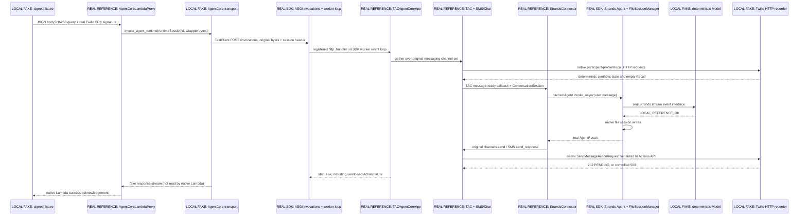

# Stage 0.5 — Local messaging reference reproduction

Date: 2026-10-02. Gate B: **PASS (8 local tests)**. Overall mandatory acceptance: **PASS, with explicit Gate A export alias**. Upstream targeted compatibility: **PARTIAL**, because unsafe network paths are separately recorded and skipped in the safe subset. Neither a Lambda 200 nor a model string is the success criterion: the real response path produced an observable SEND_MESSAGE Action.

## Environment

Windows 11 build 26200；CPython 3.13.9；uv 0.11.16；fresh workspace `.venv/`，不共享全局 site-packages。精确依赖定义、全部 runtime/build pins、lock 来源偏差和原生导入失败见 [reproducibility freeze](stage0.5-reproducibility-freeze.md)。已安装 80 个 distributions；包清单见 `reproduction/evidence/gate-a-imports-compatible.json`。参考 SHA 均固定；无其他项目代码或环境。

## Architecture executed



SDK 的原生 ASGI `/invocations` 与 worker loop 实际运行；没有调用自写 fixture→Agent handler。Native TACAgentCoreApp 分发给默认 SMS 与 Chat，Chat 自己过滤 SMS 事件。原生 Voice 对象和 WebSocket handler 随默认 connector/app 构造，但没有连接、调用、实现或测试 Voice slice。

唯一 import alias 与 Gate A 相同。Fake boto client 只提供 bedrock-agentcore transport；explicit region 避免 Session/metadata；未使用的 presigning client 构造替换为空，任何 Voice 路由都不在本地测试输入中。TAC 配置从 dummy literal 创建，避免 deployment main 自动读 Secrets Manager。Agent factory 通过 AST 获取原始 main 的 system_prompt，使用实际 Agent 和实际 FileSessionManager；只注入 fake Model 和本地 storage_dir。

Twilio native BaseAPIClient 的 HTTPX Client/AsyncClient 构造保留 auth、headers、timeout、原始 API 方法、models 和序列化，仅 transport 注入 MockTransport。只接受两个预期 host 和已实现 endpoint；意外 endpoint 抛错，不返回宽松成功。Fake server 支持 config discovery、participant list/PUT full replacement、profile Lookup/create/get、空 Recall、Action 202/503，所有逻辑 HTTP 请求与响应都保留。Happy path 将两个 UNKNOWN participant 通过原生协调升级为 AI_AGENT/CUSTOMER，并创建 profile。

## Commands

执行目录为工作区根。安装命令见 freeze 文档；主要运行命令如下。

```powershell
.\.venv\Scripts\python.exe -B reproduction\scripts\run_local.py --suite local
.\.venv\Scripts\python.exe -B reproduction\scripts\run_local.py --suite aws
.\.venv\Scripts\python.exe -B reproduction\scripts\run_local.py --suite python
.\.venv\Scripts\python.exe -B reproduction\scripts\run_local.py --suite python-safe
.\.venv\Scripts\python.exe -B reproduction\scripts\run_local.py --suite python-dedup
.\.venv\Scripts\python.exe -B reproduction\scripts\run_local.py --suite demo
```

Runner 的 exact pytest target/arguments、唯一 JUnit 路径和 basetemp 都在 `commands.jsonl`；`task-tool-inputs.jsonl` 记录本任务所有工具输入，包括完整 read-only shell 检查及文件创建操作（不包括过去 Stage 0/交付任务或工具输出）。最终核对命令为 root `git status --short`、两 refs 的 `git status --short` 和 HEAD，以及 protected hashes。无 commit/push 命令。

首次 local 运行因 `.runtime` 父目录尚未创建出现 8 setup errors；第二次发现两处 harness test 假设错误：ActionContent 没有 `type` 且 Strands result 含换行、Agent 没有 public `session_manager` 属性。只修正 reproduction setup/断言和注入 factory 的 manager observability，未修改 reference。原失败 JUnit/日志保留；最终 local 8 PASS。

最终审计首次误用 SHA256 比较 npm tarball 的 SHA512 integrity 格式；核对脚本现按 manifest 的算法验证，7 个 archive hashes 全部匹配，没有修改档案。

## Tests

| Test | Result | Evidence |
|------|--------|----------|
| 1. valid signature / happy path | PASS | `test-happy-path.json`: actual RequestValidator accepts；runtimeSessionId、wrapper bytes、参与者和完整 Action 断言 |
| 2. invalid signature | PASS | `test-invalid-signature.json`: Lambda 403，0 AgentCore invocations，0 Actions，0 Agents |
| 3. same-conversation reuse | PASS | `test-same-conversation.json`: factory=1，同对象，4 条 user/assistant history，2 Actions，第二次 model input 含历史 |
| 4. conversation isolation | PASS | `test-isolation.json`: 两个 Agent、两个 FileSessionManager、独立 history/model inputs，2 Actions |
| 5. duplicate retained token | PASS | `test-duplicate.json`: Lambda 转发两次，SMS retained token 抑制第二次；1 model turn / 1 Action |
| 6. failed Action acknowledgement | PASS (limitation reproduced) | `test-failure.json`: Action 503、0 accepted Actions、SDK status ok、Lambda 200、已保存 user+assistant、retry suppressed |
| 7. file session reconstruction | PASS | `test-reconstruction.json`: dispose/recreate 后同目录恢复两条历史；新目录为空；真实 JSON 文件被读取 |
| 8. bounded cache eviction | PASS (limitation reproduced) | `test-bounded-cache.json`: supported capacity=2，old/middle/new/old 产生 4 Actions，旧 token 被淘汰后重新处理 |
| Demo | PASS | `messaging-demo.json`；`demo-network-guard-*.json`: external attempts=0；持久 demo 文件在 `.runtime/session-storage/` |
| AWS selected upstream | PASS: 62 / FAIL: 0 / SKIP: 0 | `aws-tests-*.xml`, `aws-*.log`, guard external attempts=0；四个请求指定文件；不是 complete suite |
| Python selected upstream, original run | pytest PASS: 66 / FAIL: 0 / SKIP: 0; **outer safety FAIL** | `python-tests-*.xml`, `python-network-guard-*.json`: 6 次未 mock DNS attempts，5 tests；全部被阻断，无 API 调用 |
| Python safe selected subset | PASS: 61 / FAIL: 0 / SKIP: 5 | `python-safe-tests-*.xml`，guard external attempts=0；source/assertions 未改，runner 明确 skip |
| Python extra RCS/Chat dedup | pytest PASS: 2 / FAIL: 0 / SKIP: 0; **outer safety FAIL** | `python-dedup-tests-*.xml`，两个未 mock participant lookup 的 DNS attempts 被阻断 |

AWS targets：`test_strands_connector.py`, `test_agentcore_lambda.py`, `test_validation.py`, `test_connector_channels.py`。其中已有 TwiML unit tests 只在 mock/presigning setup 下运行；没有构建 Voice WebSocket slice。Python targets：`test_sms_channel.py`, `test_participant_reconciliation.py`, `test_memory_fallback.py`, `test_session.py`, `test_session_manager.py`；另单独运行 RCS 的 `test_webhook_deduplication` 与 Chat 的 `test_deduplication`。

安全子集 skip：SMS `test_process_message_auto_initialize`, `test_process_message_with_existing_conversation`, `test_callback_auto_send_response`, `test_callback_no_auto_send_on_none`，Memory fallback `test_retrieve_memory_with_memory_configured`。这些测试只读使用 dummy fixtures，但没有 mock 新的 participant/profile 查询路径；参考错误处理吞掉 guard 异常，因此 pytest 仍绿。**不能从断言绿推断没有网络尝试。**没有修改其断言或修复参考逻辑。初次 Python run 的旧 commands ledger 记录的是 pytest exit=0，而外层实际 exit=1；runner 已修正，后续 ledger 区分这两个 exit codes。

## Observed state

- Agent cache：原生 `conversation_agents` 以 conversation ID 为 key；factory count 和 object identity 为外部注入观测。相同进程同 conversation 复用；另一 conversation 不共享 Agent/history。
- TAC ConversationSession：SMS `_conversations` 内含 author_info、ai_agent_info、profile_id、channel=SMS、channel_id metadata；完整 model_dump 在证据内。Fake profile server 返回 empty traits，Recall 为 empty，MemoryPromptBuilder 无额外上下文，不产生额外初始化 model turn。
- Token cache：原生 OrderedDict，默认容量 10000，SMS 与 Chat 各自缓存；retained token suppression 与容量为 2 的诊断均实测。没有将 token 存入 durable store。
- 文件会话：demo 真实创建 `session_conv_local_001/session.json`、`agents/agent_default/agent.json`、`messages/message_0.json` 与 `message_1.json`。证据保存内容；多轮测试还有后续 message 文件。同 storage/session ID 的真实构造 hook 恢复历史；新目录没有历史。不是 workflow recovery。
- Fake external state：所有 config/participant/profile/Recall/Action 请求都有 method、URL、request body、response/status；只 accepted Actions 进入 `outbound_actions`。失败请求留在 HTTP calls，未伪记为成功交付。Action 202/PENDING 只表示 fake API 接收，不表示真实 carrier delivery。

## Outbound Action evidence

以下是 `messaging-demo.json` 中实际 native Action 序列化结果（不是手写输出），外层 conversation ID 是 `conv_local_001`。

```json
{
  "type": "SEND_MESSAGE",
  "payload": {
    "from": {"participantId": "participant_agent_local", "channel": "SMS"},
    "to": [{"participantId": "participant_customer_local", "channel": "SMS"}],
    "content": {"text": "LOCAL_REFERENCE_OK\n"},
    "channelSettings": {"channelId": "channel_sms_local"}
  }
}
```

输入 Communication content 有 `type=TEXT`；输出 ActionTextContent 的原生 wire model 没有该字段。未为了输出美观去掉 AgentResult 的换行。

## Observed limitations

Stage 0 关于有限、进程内去重与处理前插入 token 的判断已由 tests 5/6/8 支持。Action 失败后返回 success、保存 assistant history、token 保留、同 token retry 不再次尝试发送，显示 acknowledgement/history/delivery 没有整轮事务。没有 delivery reconciliation、custom retry 或 durable dedup 改造。

TACAgentCoreApp 每 channel exception containment 与 Lambda 不读取 service response 是原生源码行为；本 slice 的控制故障位于 Action API，被 channel 吞掉，实际 SDK response 为 ok。未把这一次故障泛化为所有 transport/Agent failure 都会 200。`UnreadResponse.read()` 若被调用会抛断言，但原生 Lambda 未读取它。

重建 Agent 只恢复 Strands 文件历史，不恢复 TAC token cache、Agent factory cache、TAC session、发送状态或未完成任务。跨进程幂等、global ordering、并发竞争和 crash-time atomicity 没有在此任务中实测；Stage 0 中关于它们的源代码限制仍是 source-derived，不能写成 runtime proof。相同进程顺序测试没有证明多 worker 可靠性。

## Deviations

1. Windows CPython 3.13.9 代替 AgentCore managed PYTHON_3_14/ARM64 runtime，未执行 CDK/CodeZip/Docker。
2. 一个明确的 import-export alias；canonical 函数对象身份保持，参考源码未改，Voice 不运行。
3. dummy config/auth/API keys；Secrets Manager startup 被 literal 配置替代；不用真实凭据，不导入有启动副作用的 deployment main。
4. boto managed invocation transport 是 fake；原 bytes 与 runtimeSessionId 进入真实 SDK ASGI route，但无 AWS service auth/routing/microVM、ARN/ID validation、session retention guarantee。
5. 同一进程容纳两 conversation，用 native conversation map 隔离；不等价于云 microVM 隔离。
6. HTTPX transport fake Twilio APIs，稳定 synthetic IDs/电话号码、无 pagination/service concurrency/实际 rate limiting；202/503 由 fixture 控制。
7. 空 traits/Recall；native 查询和模型执行保留，未复现非空 semantic recall/ranking。Memory fallback 仅通过安全的 upstream tests 覆盖，不能声称 live Memory 可用。
8. 真实 Strands model abstraction 使用 deterministic Model；不执行 Bedrock/token billing/真实 streaming service/tools。
9. FileSessionManager 指向本地 `.runtime`，代替 `/mnt/workspace/.sessions`，无 cloud filesystem/managed session-storage guarantee。
10. telemetry/export 禁用；loopback 只用于 Windows asyncio 自唤醒，全部应用 HTTP 在进程内；不测试 Lambda Function URL/AWS auth/network ingress。
11. test-safe 外部 factory counters/model call snapshots 和 supported dedup_capacity=2 诊断；未改参考类以暴露 internals；结束时停止本地 SDK daemon worker resources。
12. 不安全 upstream 测试以外层 DNS guard 阻断并记录，safe subset 在 runner 中明确 SKIP；不修改源断言，不宣称 complete suite compatibility。

## Not verified

真实 Twilio API 合同/Actions delivery/回调重试、Bedrock 输出、AWS IAM/Secrets、AgentCore microVM routing/retention/sessionStorage、CDK bundling/deploy、Linux/ARM64/Python 3.14 环境、Voice、非空 Memory、并发和 crash recovery、完整 upstream suite、生产可靠性：全部 **NOT VERIFIED**。

## Final validation and created files

`reproduction/evidence/final-validation.json` 核对两个 exact SHAs 与完整 `git status --short`、root HEAD 未变化、五个 Stage 0 docs/README/原 untracked CSV 的 SHA256 未变化、依赖 archives 与 source-contract hashes 未变化。参考 tracked/index 均 clean。root 唯一已有 tracked 修改是 `.gitignore`，只排除 workspace-local env/cache/runtime。

新增：`reproduction/README.md`, `.python-version`, `pyproject.toml`, `uv.lock`；`scripts/` 候选、freeze wrapper、import/source inspection、guarded runner、审计导出与最终验证；`src/twilio_local_ref/` compatibility/safety/source pins/model/harness；`fixtures/` 两个 dummy JSON；`tests/test_messaging.py`；`evidence/` 全部结果；本文和 freeze 文档。生成目录 `.venv/`、`.cache/`、`reproduction/.runtime/`。完整逐文件清单与目录数量见 `files-outside-references.json`，不会把原 untracked CSV 计为新创建文件。

AWS application API calls: **NO**. Twilio API calls: **NO**. Bedrock API calls: **NO**. Public package downloads: **YES**, allowed. No real credentials required. No Voice implementation, final project architecture, reliability fixes, commit or push. 本地消息参考基线已准备好供下一项任务使用；本任务到此停止。
